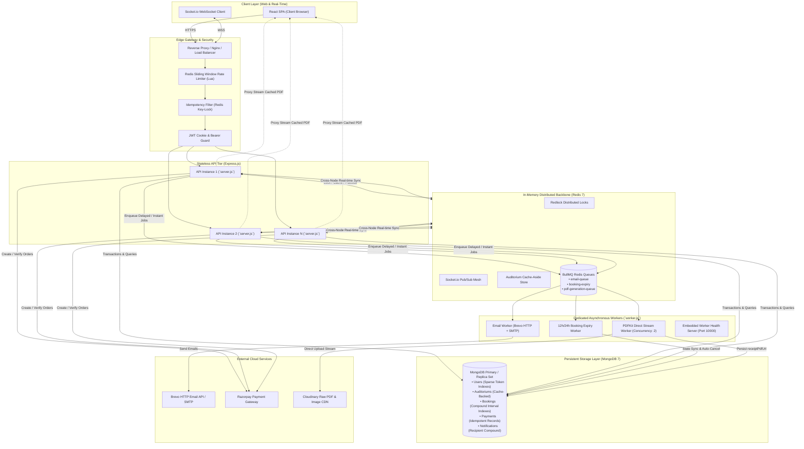
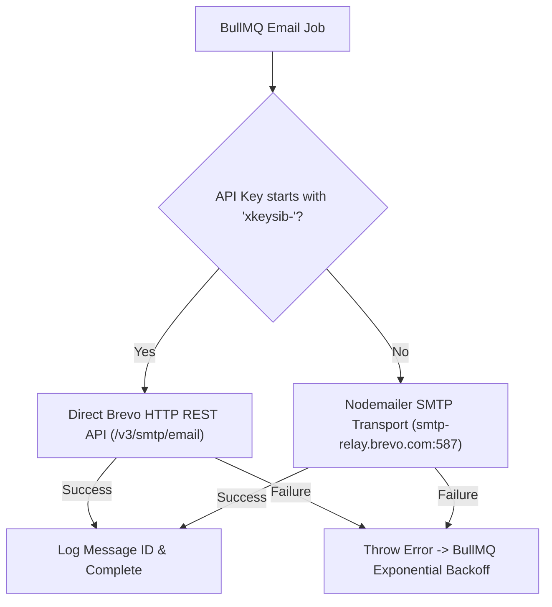
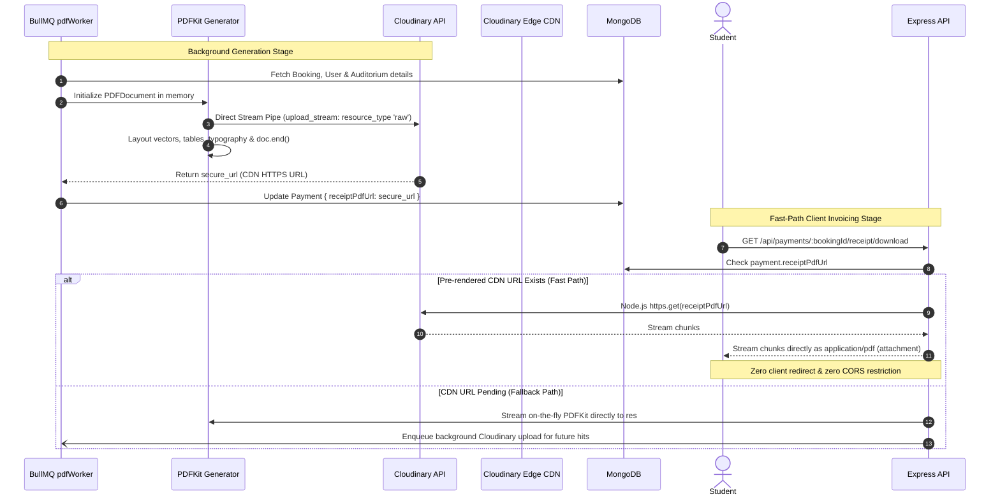
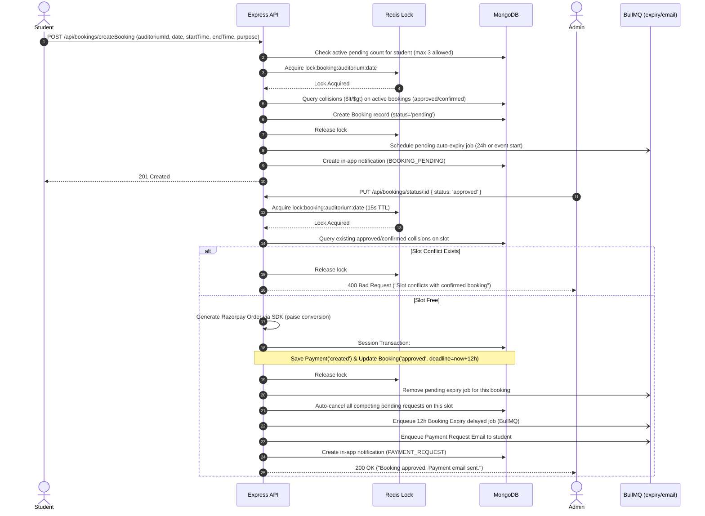
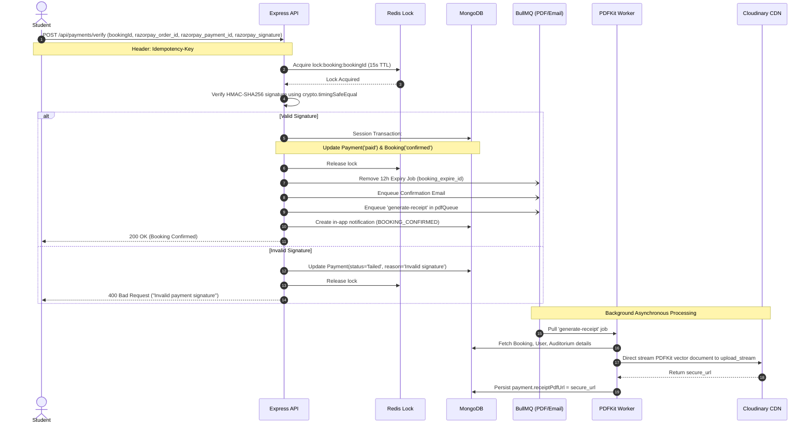
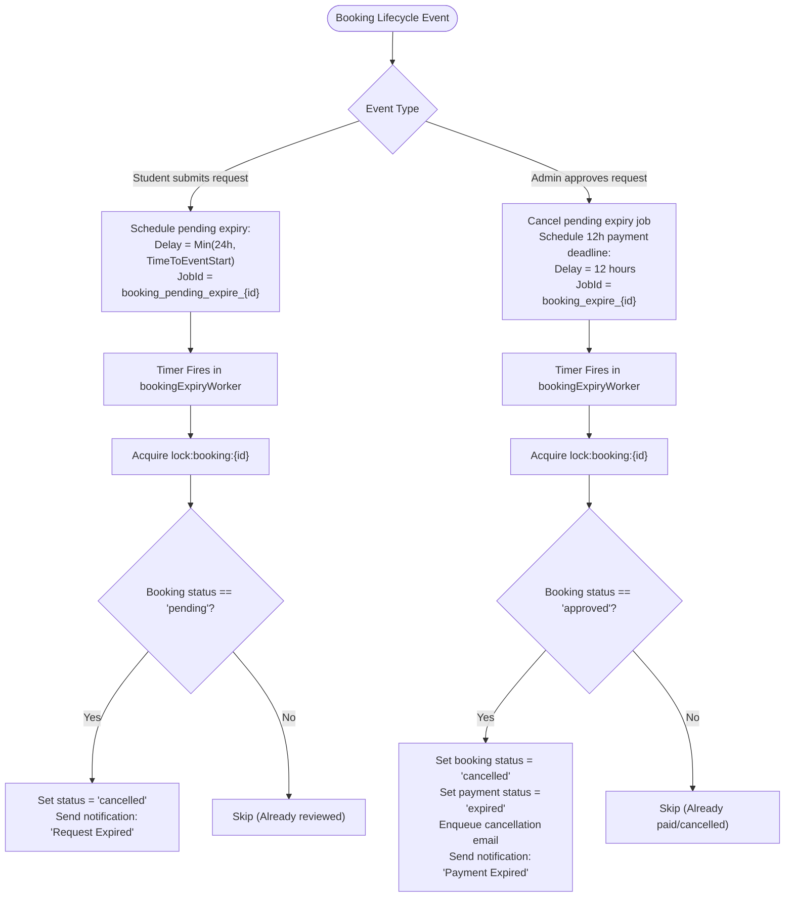

# 🏛️ AuditoReserve — System Architecture & Technical Design

Welcome to the comprehensive technical architecture specification for **AuditoReserve**. This document outlines the architectural blueprints, distributed concurrency controls, asynchronous job pipelines, security frameworks, database topologies, and deployment specifications engineered into the backend platform.

---

## 📌 Table of Contents

- [1. High-Level Architecture Overview](#1-high-level-architecture-overview)
- [2. Core Architectural Principles](#2-core-architectural-principles)
- [3. Subsystem Deep-Dive](#3-subsystem-deep-dive)
  - [3.1 API Gateway, Security & Idempotency Pipeline](#31-api-gateway-security--idempotency-pipeline)
  - [3.2 Distributed Concurrency & Locking (Redlock)](#32-distributed-concurrency--locking-redlock)
  - [3.3 Asynchronous Queue Processing (BullMQ)](#33-asynchronous-queue-processing-bullmq)
  - [3.4 Transactional Dual-Engine Email Subsystem](#34-transactional-dual-engine-email-subsystem)
  - [3.5 Direct Stream Media & Zero-Disk PDF CDN Pipeline](#35-direct-stream-media--zero-disk-pdf-cdn-pipeline)
  - [3.6 Multi-Node Real-Time WebSockets (Redis Pub/Sub Adapter)](#36-multi-node-real-time-websockets-redis-pubsub-adapter)
  - [3.7 Data Layer, Schemas & Compound Index Topology](#37-data-layer-schemas--compound-index-topology)
- [4. End-to-End Sequence Workflows](#4-end-to-end-sequence-workflows)
  - [4.1 Booking Submission & Admin Conflict-Guarded Approval](#41-booking-submission--admin-conflict-guarded-approval)
  - [4.2 Payment Verification & Async CDN Invoicing Pipeline](#42-payment-verification--async-cdn-invoicing-pipeline)
  - [4.3 Dual-Level Auto-Expiry Worker Lifecycle](#43-dual-level-auto-expiry-worker-lifecycle)
- [5. Reliability, Database Transactions & Fault Tolerance](#5-reliability-database-transactions--fault-tolerance)
- [6. Automated Verification & Testing Coverage](#6-automated-verification--testing-coverage)
- [7. Horizontal Scaling & Cloud Deployment Blueprint](#7-horizontal-scaling--cloud-deployment-blueprint)

---

## 1. High-Level Architecture Overview

AuditoReserve operates on a **decoupled, event-driven micro-service topology** separating synchronous HTTP/WebSocket ingress from asynchronous background processing. Computationally intensive tasks (PDF vector document compilation, transactional email dispatches, delayed payment expirations) are strictly offloaded from the Express event loop to independent BullMQ worker services.



---

## 2. Core Architectural Principles

1. **Stateless API Ingress:** API nodes retain no local sessions, state, or temporary files. Session validity is established via cryptographic JWTs (HttpOnly cookies or `Authorization: Bearer` headers), allowing seamless load distribution across arbitrary API instances.
2. **Decoupled Execution Pipelines:** HTTP controllers maintain execution times $< 25\text{ms}$ by delegating deferred side-effects (PDF assembly, emails, auto-cancellation timers) to background BullMQ queues.
3. **Optimistic & Distributed Concurrency Guarding:** Reservation requests, administrator approvals, and payment verifications utilize Redis-backed distributed locks (Redlock) combined with MongoDB multi-document transactions to eliminate race conditions and double-booking.
4. **Cache-Aside with Automated Purge:** High-traffic catalog queries (`/viewAllAuditoriums`, `/viewAuditorium/:id`) read from Redis with automatic database fallback and proactive cache eviction on administrative updates.
5. **Zero-Disk Media Streaming:** Dynamically generated PDF receipts stream directly from Node.js memory into Cloudinary CDN storage and are proxied directly to clients, preventing ephemeral container disk overflow.

---

## 3. Subsystem Deep-Dive

### 3.1 API Gateway, Security & Idempotency Pipeline

Every request entering the Express pipeline traverses a layered security pipeline:

```
[Incoming Request]
       │
       ▼
[Trust Proxy] ───────────────► Resolves client IP across load balancers / reverse proxies
       │
       ▼
[Helmet & CORS] ────────────► Strict security headers & whitelisted domain check
       │
       ▼
[Atomic Sliding-Window] ─────► Redis Sorted Sets + Lua script per endpoint category
       │
       ▼
[Idempotency Filter] ────────► Redis request lock & cached response replayer
       │
       ▼
[JWT Authentication Guard] ──► Decodes access token from HttpOnly cookie or Bearer header
       │
       ▼
[Role & Verification Guard] ─► Validates student/admin roles & email verification status
       │
       ▼
[Zod Schema Validator] ──────► Strict validation of params, query, and request body
       │
       ▼
[Controller Handler]
```

#### Redis Sliding-Window Rate Limiting (Lua-Driven)
Unlike naive fixed-window limiters that suffer from boundary burst vulnerabilities, AuditoReserve executes an atomic Lua script over Redis Sorted Sets (`ZREMRANGEBYSCORE`, `ZCARD`, `ZADD`, `PEXPIRE`). Each endpoint category operates a distinct rate limit profile:

| Endpoint Domain | Rate Limit Prefix | Window | Max Requests | Key Scope |
| :--- | :--- | :--- | :--- | :--- |
| **Auth General** | `rl:auth:general` | 15 mins | 60 | IP / Client ID |
| **Auth Register** | `rl:auth:register` | 15 mins | 5 | IP / Client ID |
| **Auth Login** | `rl:auth:login` | 15 mins | 10 | IP / Client ID |
| **Password Reset** | `rl:auth:forget-password` | 15 mins | 5 | IP / Client ID |
| **Resend Verification**| `rl:auth:resend-verify` | 15 mins | 5 | IP / Client ID |
| **Token Refresh** | `rl:auth:refresh` | 15 mins | 30 | IP / Client ID |
| **Auditorium View**| `rl:auditorium:view` | 1 min | 60 | Client ID / IP |
| **Auditorium Mutate**| `rl:auditorium:mutate`| 1 min | 10 | Client ID / IP |
| **Booking Create** | `rl:booking:create` | 1 min | 5 | Client ID / IP |
| **Booking Cancel** | `rl:booking:cancel` | 1 min | 10 | Client ID / IP |
| **Booking Calendar**| `rl:booking:calendar` | 1 min | 60 | Client ID / IP |
| **Payment Order** | `rl:payment:order` | 1 min | 6 | Client ID / IP |
| **Payment Verify** | `rl:payment:verify` | 1 min | 6 | Client ID / IP |
| **PDF Download** | `rl:payment:download` | 1 min | 10 | Client ID / IP |
| **Notifications Read**| `rl:notification:read` | 1 min | 60 | Client ID / IP |

#### Per-User Idempotency Engine
To prevent duplicate financial charges or double-verification of payments caused by client-side retries:
1. The client supplies an `Idempotency-Key` or `X-Idempotency-Key` header.
2. The key is scoped per user: `${prefix}:${userId}:${idempotencyKey}`.
3. If an existing entry has value `"PROCESSING"`, a `409 Conflict` is returned immediately.
4. If an entry has a cached response, the controller execution is bypassed and the cached payload is returned with header `X-Idempotent-Replayed: true`.
5. On the first hit, Redis sets `"PROCESSING"` with a 30-second lock timeout. The response is intercepted: status codes $< 500$ are persisted for 24 hours (`EX 86400`); internal server errors ($\ge 500$) automatically release the key to permit immediate retry.

---

### 3.2 Distributed Concurrency & Locking (Redlock)

In university auditorium management, multiple students and administrators frequently target the same venue for overlapping dates or times. To ensure data consistency across multiple API instances:

```
Request A (Admin 1 Approves Booking)      Request B (Admin 2 Approves Booking)
                │                                         │
                ▼                                         ▼
   [Acquire Lock: lock:booking:auditorium_id:date_midnight (TTL: 15s)]
                │
        ┌───────┴───────┐
        ▼               ▼
   Lock Acquired   Lock Rejected (409 Conflict)
        │               │
        │               └─► "Another booking process is running for this auditorium."
        ▼
   DB Conflict Check ($lt / $gt)
   Razorpay Order + Payment Save (Session Transaction)
   Auto-Decline Competing Pending Requests
   Enqueue 12h Expiry Timer in BullMQ
   Release Lock via Atomic Lua Script (Token Verification)
```

#### Lock Implementation
- **Acquire:** `redisClient.set(key, lockValue, "NX", "PX", ttlMs)` generates a cryptographically random UUID token (`lockValue`).
- **Safe Release:** Executed via an atomic Lua script:
  ```lua
  if redis.call("GET", KEYS[1]) == ARGV[1] then
    return redis.call("DEL", KEYS[1])
  else
    return 0
  end
  ```
  This ensures that a slow process whose lock expired does not inadvertently release a newly acquired lock held by another process.
- **Lock Scopes:**
  - `lock:booking:${auditoriumId}:${bookingDay}` — Enforced during booking creation and admin approval.
  - `lock:booking:${bookingId}` — Enforced during payment verification vs. `bookingExpiryWorker` auto-cancellation.

#### Overlap Formula
An interval collision occurs when:
$$\text{Collision} \iff (\text{Existing.startTime} < \text{New.endTime}) \land (\text{Existing.endTime} > \text{New.startTime})$$

---

### 3.3 Asynchronous Queue Processing (BullMQ)

AuditoReserve operates three dedicated BullMQ queues backed by Redis:

| Queue Identifier | Worker Module | Primary Responsibilities | Concurrency & Retry Policy |
| :--- | :--- | :--- | :--- |
| **`email-queue`** | `worker/emailWorker.js` | Verification emails, reset password links, booking status updates, payment requests | Standard concurrency; BullMQ retry handlers |
| **`booking-expiry`** | `worker/bookingExpiryWorker.js` | Enforces 24h pending review expiration and 12h payment deadline expiration | Distributed lock guard (`lock:booking:${bookingId}`); exponential backoff on lock contention |
| **`pdf-generation-queue`** | `worker/pdfWorker.js` | Streams vector PDFKit invoices to Cloudinary CDN & saves `receiptPdfUrl` | **Concurrency: 2** (prevents memory spikes during vector layout) |

#### Dedicated Worker Architecture (`worker.js`)
In production environments, background jobs run in a distinct container process launched via `npm run start:worker`. To prevent container orchestration and cloud platforms (such as Render Web Services) from terminating the process due to missing port bindings, `worker.js` includes an ultra-lightweight dummy HTTP server listening on `PORT` (or `10000`):
- `GET /` $\rightarrow$ `200 OK: "Worker is active and running"`
- Gracefully handles `SIGINT` and `SIGTERM`, awaiting completion of active jobs, closing worker connections, and shutting down MongoDB and Redis pools safely.

---

### 3.4 Transactional Dual-Engine Email Subsystem

To guarantee reliable email delivery across development, staging, and production environments, `service/email.js` implements a resilient dual-engine strategy:



1. **Primary: Brevo HTTP REST API (`https://api.brevo.com/v3/smtp/email`)**
   - Automatically selected when `BREVO_API_KEY` starts with `xkeysib-`.
   - Bypasses SMTP port blocking (common on cloud hosts like AWS, DigitalOcean, and Render) and executes via standard HTTPS POST with JSON payload.
2. **Fallback: Nodemailer SMTP Transport**
   - Activated when standard SMTP credentials (`SMTP_HOST`, `SMTP_PORT`, `SMTP_USER`, `SMTP_PASS`) are configured.

---

### 3.5 Direct Stream Media & Zero-Disk PDF CDN Pipeline

Traditional PDF receipt generation writes temporary files to server disks, introducing disk exhaustion vulnerabilities and failure modes on stateless or read-only container filesystems.



- **Receipt Download:** Served via `GET /api/payments/:bookingId/receipt/download`. Streams the pre-generated Cloudinary PDF through Node's HTTPS client directly to the browser response. This eliminates client-side CORS issues associated with 302 redirects to third-party domains while consuming zero server CPU for PDF rendering.
- **Receipt Preview:** `GET /api/payments/:bookingId/receipt` returns structured JSON data or streams inline PDF if `?format=pdf` is provided.

---

### 3.6 Multi-Node Real-Time WebSockets (Redis Pub/Sub Adapter)

To scale WebSocket connections horizontally across distributed application instances, the platform integrates `@socket.io/redis-adapter` with dual Redis clients (`pubClient` and `subClient`):

1. **Authentication Handshake:** During connection, the socket handshake extracts the access token from either:
   - `cookie: accessToken`
   - `auth: { token: "..." }`
   - `headers: { authorization: "Bearer ..." }`
   Validates the JWT and binds `socket.userId = decoded.id`.
2. **User Room Multiplexing:** Sockets automatically join isolated user rooms: `user:<userId>`.
3. **Cross-Instance Notification Dispatch:** Calling `sendRealTimeNotification(userId, notification)` emits to `io.to("user:" + userId).emit("notification", notification)`. Redis Pub/Sub broadcasts the message across all connected server instances, ensuring real-time arrival regardless of which node terminates the client's WebSocket connection.

---

### 3.7 Data Layer, Schemas & Compound Index Topology

The database architecture employs **MongoDB 7** with Mongoose ODM schemas structured with indexes optimized for low-latency queries and lock evaluations:

#### 1. `Booking` Schema
- Fields: `user` (ref: User), `auditorium` (ref: Auditorium), `bookingDate` (Date), `startTime` (String: HH:MM), `endTime` (String: HH:MM), `purpose` (String), `status` (Enum: `pending`, `approved`, `confirmed`, `cancelled`), `totalPrice` (Number), `paymentId` (ref: Payment), `approvedAt` (Date), `paymentDeadline` (Date).
- **Compound Indexes:**
  - `{ auditorium: 1, status: 1, bookingDate: 1, startTime: 1, endTime: 1 }` — High-speed slot collision and availability queries.
  - `{ user: 1, createdAt: -1 }` — Student dashboard personal booking history.
  - `{ createdAt: -1 }` — Admin operational dashboard listing.
  - `{ status: 1, paymentDeadline: 1 }` — Rapid discovery for payment auto-expiry background workers.

#### 2. `Payment` Schema
- Fields: `user` (ref: User), `booking` (ref: Booking), `amount` (Number), `currency` (String, default: "INR"), `gateway` (String, default: "razorpay"), `gatewayOrderId` (String, unique), `gatewayPaymentId` (String, unique, sparse), `gatewaySignature` (String), `status` (Enum: `created`, `paid`, `failed`, `expired`, `refunded`), `receipt` (String, unique), `expiresAt` (Date), `paidAt` (Date), `failureReason` (String), `receiptPdfUrl` (String, default: null).
- **Indexes:**
  - `{ booking: 1 }` — O(1) payment verification lookups.
  - `{ user: 1, createdAt: -1 }` — User billing history.
  - `{ status: 1, expiresAt: 1 }` — Expired payment lookups.

#### 3. `Auditorium` Schema
- Fields: `name` (String), `capacity` (Number), `amenities` ([String]), `images` ([String]), `basePrice` (Number), `description` (String, max 500 chars).
- **Protection:** Deletion is blocked if active bookings (`pending`, `approved`, `confirmed`) exist; associated Cloudinary assets are automatically purged upon deletion.

#### 4. `User` Schema
- Fields: `name` (String), `email` (String, unique, lowercase), `password` (String, bcrypt hashed), `role` (Enum: `student`, `admin`), `refreshToken` (String), `isVerified` (Boolean), `verificationToken` (String), `verificationTokenExpires` (Date), `resetPasswordToken` (String), `resetPasswordExpires` (Date).
- **Sparse Indexes:**
  - `{ refreshToken: 1 }`, `{ verificationToken: 1 }`, `{ resetPasswordToken: 1 }` (configured as `{ sparse: true }` to conserve memory and index space).

#### 5. `Notification` Schema
- Fields: `recipient` (ref: User), `type` (Enum: `BOOKING_PENDING`, `BOOKING_APPROVED`, `BOOKING_CANCELLED`, `BOOKING_CONFIRMED`, `PAYMENT_REQUEST`, `PAYMENT_SUCCESS`, `SYSTEM`), `title` (String), `message` (String), `isRead` (Boolean, default: false), `data` (Object with `bookingId`, `paymentId`).
- **Compound Indexes:**
  - `{ recipient: 1, createdAt: -1 }` — Feed pagination.
  - `{ recipient: 1, isRead: 1 }` — Unread count badge query.

---

## 4. End-to-End Sequence Workflows

### 4.1 Booking Submission & Admin Conflict-Guarded Approval



---

### 4.2 Payment Verification & Async CDN Invoicing Pipeline



---

### 4.3 Dual-Level Auto-Expiry Worker Lifecycle

The platform enforces two distinct levels of automated slot release:



---

## 5. Reliability, Database Transactions & Fault Tolerance

1. **ACID MongoDB Transactions:** Multi-document state transitions (such as approving a booking while creating a Payment record, or confirming a booking while marking payment as paid) execute inside `mongoose.startSession()` transactions with automatic abort on error.
2. **Cryptographic Timing Attack Defense:** Payment verification uses `crypto.timingSafeEqual` over buffers rather than string equality to defend against timing analysis attacks.
3. **Graceful Shutdown Protocol (`SIGTERM` / `SIGINT`):**
   - HTTP listener stops accepting incoming connections.
   - Active BullMQ workers finish processing in-flight jobs.
   - BullMQ queues close their connection pools cleanly.
   - Socket.IO and Redis Pub/Sub adapter instances close.
   - MongoDB connection pool terminates gracefully.
   - A 10-second watchdog timer guarantees shutdown in event of unresponsive connections.
4. **Idempotent Retry Resiliency:** Duplicate payment verification requests return immediate `200 OK` if the booking is already confirmed, eliminating duplicate transactions.

---

## 6. Automated Verification & Testing Coverage

The backend is backed by an automated test suite executed via Jest and Supertest, consisting of **21 test suites and 136 passing tests** across unit, integration, worker, and security domains:

```
Test Suites: 21 passed, 21 total
Tests:       136 passed, 136 total
Snapshots:   0 total
```

### Coverage Areas:
- **Integration Tests:**
  - `authRoutes.test.js`: Domain validation, token rotation, verification tokens, logout, reset password.
  - `auditoriumRoutes.test.js`: Caching, image upload mocks, active booking deletion guard.
  - `bookingRoutes.test.js`: Collision checks, time normalization, admin approval, multi-status workflows, calendar queries.
  - `paymentRoutes.test.js`: Order initialization, signature verification, idempotent re-verification, PDF generation, receipts.
  - `notificationRoutes.test.js`: Pagination, unread counter, bulk mark read, ownership-scoped deletion.
  - `concurrencyAndSecurity.test.js`: Simultaneous approval race conditions, concurrent payment submissions with same idempotency key, role escalation prevention, forged JWT signatures, NoSQL injection resistance.
- **Unit & Worker Tests:**
  - `bookingExpiryWorker.test.js`, `pdfWorker.test.js`, `emailWorker.test.js`.
  - `lock.test.js` (Redlock acquisition, token mismatch safety, mutual exclusion).
  - `rateLimiter.test.js` (Sliding window enforcement, Redis offline fail-open).
  - `idempotencyMiddleware.test.js` (Processing locks, cached replay, 500 error eviction).
  - `receiptGenerator.test.js` (Vector PDFKit document validation).
  - `cloudinaryHelper.test.js`, `jwt.test.js`, `errorMiddleware.test.js`.

---

## 7. Horizontal Scaling & Cloud Deployment Blueprint

AuditoReserve is containerized with Docker and structured for horizontal cloud scaling across container platforms (Render, AWS ECS, Railway, Google Cloud Run):

```
                                [ Internet Traffic ]
                                         │
                                         ▼
                            [ Cloudflare / ALB Ingress ]
                                         │
                 ┌───────────────────────┴───────────────────────┐
                 ▼                                               ▼
       [ API Service Container 1 ]                     [ API Service Container 2 ]
       - Express HTTP & Socket.io                      - Express HTTP & Socket.io
       - Node 20 Non-root Alpine                       - Node 20 Non-root Alpine
                 │                                               │
                 ├───────────────────────┬───────────────────────┤
                 │                       │                       │
                 ▼                       ▼                       ▼
       [ Dedicated Redis 7 ]    [ MongoDB 7 Cluster ]  [ Dedicated Worker Container ]
       - BullMQ Job Storage     - Primary (Writes)     - node src/worker.js
       - Redlock Concurrency    - Secondaries (Reads)  - Embedded Port 10000 Health Server
       - Socket.IO Pub/Sub mesh - Compound Indexes     - BullMQ Email, Expiry & PDF Workers
       - Sliding Rate Limiter
```

### Scaling Guidelines:
1. **Separation of API and Worker Services:** Scale the Express API service on request volume; scale the worker container independently based on BullMQ queue latency and PDF processing load.
2. **Redis High Availability:** For multi-region production, deploy Redis Sentinel or AWS ElastiCache for automated master-replica failover.
3. **Database Read Offloading:** Read queries (`/viewAllAuditoriums`, `/calendar`) utilize Redis caching and can safely target secondary MongoDB read-replicas.
