# AuditoReserve — Frontend Architecture & UI Overview

> **Purpose:** This document is a comprehensive, self-contained architectural reference of the frontend codebase. It provides another AI agent or engineer everything required to completely redesign or rebuild the user interface without breaking existing routes, workflows, backend integrations, or business logic.

---

## 1. Project Structure

The frontend is a modern single-page application (SPA) built with Vite, React, React Router, TanStack Query, and Framer Motion.

```
frontend/
├── index.html                     # HTML entry point (Plus Jakarta Sans font, favicon)
├── package.json                   # Dependencies and npm scripts
├── vite.config.js                 # Vite configuration with vendor chunk splitting
├── tailwind.config.js             # Tailwind config (palette configured, but dormant)
├── postcss.config.js              # PostCSS plugins (autoprefixer, tailwindcss)
├── jsconfig.json                  # Compiler and bundler path options
├── netlify.toml                   # SPA redirect rules for Netlify deployment
├── .env.example                   # Template for environment variables
├── .env                           # Active environment variables (git-ignored)
├── public/
│   ├── favicon.svg                # Application favicon
│   └── icons.svg                  # Unused SVG sprite
└── src/
    ├── main.jsx                   # React root mount (StrictMode)
    ├── App.jsx                    # Root router, query client, contexts, routes
    ├── App.css                    # Monolithic custom design system (3,400+ lines)
    ├── index.css                  # Global resets (box-sizing, cursor)
    ├── types.js                   # Empty file (leftover from TypeScript conversion)
    ├── api/                       # API clients & backend communication
    │   ├── client.js              # Axios instance, token interceptors, 401 refresh mutex
    │   ├── auth.js                # Auth endpoints (login, register, reset, verify)
    │   ├── auditoriums.js         # Auditorium CRUD endpoints & FormData builder
    │   ├── bookings.js            # Booking requests, approval, calendar endpoints
    │   ├── notifications.js       # Notification querying, read/delete mutations
    │   └── payments.js            # Razorpay order, verification, receipt download
    ├── assets/                    # Static image assets
    │   ├── hero.png               # Unused hero illustration
    │   ├── react.svg              # Vite React template icon (unused)
    │   └── vite.svg               # Vite icon (unused)
    ├── components/
    │   ├── auditoriums/
    │   │   ├── AuditoriumCard.jsx # Venue card & ImageFrame fallback
    │   │   └── AuditoriumFilters.jsx # Toolbar filters (currently orphaned)
    │   ├── auth/
    │   │   └── AuthCard.jsx       # Centered container for login/register/reset
    │   ├── bookings/
    │   │   ├── BookingReceiptModal.jsx # Full-page modal receipt preview (orphaned)
    │   │   ├── BookingRow.jsx     # Booking item card (student & admin actions)
    │   │   ├── CalendarView.jsx   # Interactive monthly availability grid
    │   │   ├── StatusTabs.jsx     # Filter tabs (pending, approved, confirmed, etc.)
    │   │   └── receipt.css        # Styles for receipt layout and print media
    │   ├── common/
    │   │   ├── ConfirmDialog.jsx  # Reusable modal confirmation dialog
    │   │   ├── ErrorState.jsx     # ErrorState and EmptyState placeholders
    │   │   ├── FormControls.jsx   # TextField (with ref), FormError, FormSuccess
    │   │   ├── LoadingSkeleton.jsx # SkeletonGrid, SkeletonTable, FullPageState
    │   │   ├── PageTransition.jsx # Framer Motion route transition wrapper
    │   │   ├── Pagination.jsx     # Numbered pagination with ellipsis & Prev/Next
    │   │   ├── Pagination.css     # Pagination bar styling
    │   │   ├── RefreshButton.jsx  # Live refresh button with TanStack invalidation
    │   │   ├── RefreshButton.css  # Refresh button styling
    │   │   ├── StatusBadge.jsx    # Status chip component (approved, pending, etc.)
    │   │   └── TimePicker.jsx     # Custom 24-hr time input (HH:MM formatting)
    │   └── layout/
    │       ├── AdminLayout.jsx    # Admin dashboard shell with sidebar & topbar
    │       ├── AppLayout.jsx      # Public/Student shell with topbar, dropdown, footer
    │       ├── Footer.jsx         # Global footer with navigation links
    │       ├── NotificationCenter.jsx # Dropdown bell with live notification list
    │       └── ProtectedRoute.jsx # ProtectedRoute and RoleRoute route guards
    ├── hooks/
    │   ├── toastContext.js        # React Context definition for toasts
    │   ├── ToastProvider.jsx      # Toast state & animated popup cards
    │   ├── useToast.js            # useToast consumer hook
    │   ├── useAuth.jsx            # AuthProvider & useAuth hook (session state)
    │   └── useNotifications.jsx   # NotificationProvider & Socket.IO client hook
    ├── lib/
    │   ├── animations.js          # Shared Framer Motion variant definitions
    │   └── razorpay.js            # Dynamic Razorpay checkout.js script loader
    ├── pages/
    │   ├── admin/
    │   │   ├── AdminAuditoriumsPage.jsx # Auditorium inventory table with actions
    │   │   ├── AdminBookingsPage.jsx    # Booking request approval/rejection queue
    │   │   ├── AdminDashboard.jsx       # Metrics dashboard & recent pending bookings
    │   │   └── AuditoriumFormPage.jsx   # Create/Edit venue form with image previews
    │   ├── auth/
    │   │   ├── ForgotPasswordPage.jsx   # Password reset request form
    │   │   ├── LoginPage.jsx            # Sign in with university email & password
    │   │   ├── RegisterPage.jsx         # Sign up with domain verification
    │   │   ├── ResetPasswordPage.jsx    # Set new password via token
    │   │   └── VerifyEmailPage.jsx      # Email verification token handler
    │   ├── public/
    │   │   ├── AboutPage.jsx            # Platform information (route redirects to /#about)
    │   │   ├── AuditoriumDetailPage.jsx # Single venue specifications & booking CTA
    │   │   ├── CatalogPage.jsx          # Public auditorium gallery with search
    │   │   └── HomePage.jsx             # Marketing landing page with hero & sections
    │   └── student/
    │       ├── AccountPage.jsx          # User profile details and session logout
    │       ├── NewBookingPage.jsx       # Venue booking request form with calendar
    │       └── StudentBookingsPage.jsx  # Student booking history, payment, cancellation
    └── utils/
        └── calendarSync.js        # Google Calendar URL and .ics file generator
```

---

## 2. Tech Stack

| Technology | Version | Purpose & Usage in Codebase |
| :--- | :--- | :--- |
| **React** | `^19.2.6` | Core UI library (`main.jsx`, lazy loading, Context API). |
| **Vite** | `^8.0.12` | Build tool and dev server. Configured with chunk splitting in `vite.config.js`. |
| **React Router DOM** | `^7.15.1` | Client-side routing, nested layouts (`<Outlet />`), route guards. |
| **@tanstack/react-query** | `^5.100.11` | Server state caching, asynchronous queries, optimistic mutations, refetching. |
| **Axios** | `^1.16.1` | HTTP client with automatic Authorization header injection and 401 refresh interceptors. |
| **Socket.IO Client** | `^4.8.3` | Real-time WebSocket notifications from server to user in `useNotifications.jsx`. |
| **React Hook Form** | `^7.76.0` | Form state management and submission in all auth, booking, and admin forms. |
| **Zod** | `^4.4.3` | Schema declaration and input validation. |
| **@hookform/resolvers** | `^5.2.2` | Connects Zod schemas to React Hook Form (`zodResolver`). |
| **Framer Motion** | `^12.40.0` | Declarative page transitions, dropdown animations, toasts, dialogs, hover interactions. |
| **Lucide React** | `^1.16.0` | Comprehensive iconography used across all components and pages. |
| **Date-fns** | `^4.2.1` | Date calculations, calendar grid computation, formatting (`formatDistanceToNow`, `format`). |
| **Razorpay Checkout** | External CDN | Injected on-demand via `loadRazorpayScript()` in `lib/razorpay.js`. |
| **Tailwind CSS / PostCSS** | `^4.3.0` | Installed with config, but **dormant** (see Section 14). Styling relies on custom CSS. |

---

## 3. Application Architecture

### 3.1 Entry Point & Root Providers Hierarchy

The application boots in `main.jsx` and wraps the component tree in three nested context providers and a QueryClientProvider:

```
<StrictMode>
  <QueryClientProvider client={queryClient}>
    <AuthProvider>                 ─── Manages user state, token, auto-refresh
      <ToastProvider>              ─── Manages ephemeral toast notification queue
        <NotificationProvider>     ─── Manages Socket.IO connection & bell badge
          <BrowserRouter>
            <Suspense fallback={<RouteFallback />}>
              <Routes> ... </Routes>
            </Suspense>
          </BrowserRouter>
        </NotificationProvider>
      </ToastProvider>
    </AuthProvider>
  </QueryClientProvider>
</StrictMode>
```

### 3.2 Layout System

The app utilizes two primary layout shells:

1. **`AppLayout` (`src/components/layout/AppLayout.jsx`)**:
   - Shell for public pages, auth pages, and student account/booking pages.
   - Includes the sticky topbar:
     - Brand logo (`AR AuditoReserve`).
     - Main navigation links (`Home`, `About`, `Features`, `Contact`).
     - Role-based links: `My bookings` (if student), `Admin Panel` (if admin).
     - Right actions: `NotificationCenter` (if logged in), Profile icon, Logout button, or `Login`/`Sign up` buttons.
     - Mobile burger menu with animated collapsible dropdown (`framer-motion`).
     - Handles smooth scrolling to anchor IDs (e.g., `/#about`, `/#features`, `/#contact`).
   - Renders `<Outlet />` wrapped inside animated page transitions.
   - Includes `<Footer />`.

2. **`AdminLayout` (`src/components/layout/AdminLayout.jsx`)**:
   - Shell exclusively for `/admin/*` routes.
   - Mobile top header with admin toggle menu button.
   - Desktop and slide-out mobile sidebar (`<aside className="sidebar">`):
     - Admin console branding.
     - Navigation links:
       - `Dashboard` (`/admin`)
       - `Auditoriums` (`/admin/auditoriums`)
       - `Bookings` (`/admin/bookings`)
     - User name and logout button in sidebar footer.
   - Renders `<Outlet />` inside animated `<main className="admin-main">`.

### 3.3 Route Protection Architecture

Route access is managed by two higher-order guard components in `src/components/layout/ProtectedRoute.jsx`:

- **`ProtectedRoute`**: Verifies that the user session is active. If `isLoading`, renders `FullPageState("Checking Session")`. If unauthenticated, redirects to `/login`.
- **`RoleRoute`**: Enforces strict role validation (`student` or `admin`). If unauthorized, automatically redirects:
  - If a student attempts to open an admin route (`/admin/*`) → Redirected to `/`.
  - If an admin attempts to open a student route (`/bookings/*`) → Redirected to `/admin`.

---

## 4. All Pages & Routes

| Path | Layout | Guard | Component File | Description & Key Features |
| :--- | :--- | :--- | :--- | :--- |
| `/` | `AppLayout` | Public | `pages/public/HomePage.jsx` | Marketing landing page: Hero with CTA, About split-section, 6-feature card grid, 3-step process timeline, contact card with phone link. |
| `/about` | — | Public | — | Redirects immediately to `/#about` via `<Navigate to="/#about" replace />`. |
| `/auditoriums` | `AppLayout` | Public | `pages/public/CatalogPage.jsx` | Public venue catalog. Live client-side text filtering by auditorium name. Renders `AuditoriumCard` grid. |
| `/auditoriums/:id` | `AppLayout` | Public | `pages/public/AuditoriumDetailPage.jsx` | Full auditorium details: multi-image gallery with active thumbnail selector, seat capacity, hourly price, amenities tags, dynamic CTA ("Request booking" for student, "Edit" for admin, "Log in" for guests). |
| `/login` | `AppLayout` | Public | `pages/auth/LoginPage.jsx` | University email & password login. Handles unverified accounts with inline "Resend verification link", links to forgot password and registration. |
| `/register` | `AppLayout` | Public | `pages/auth/RegisterPage.jsx` | Student registration. Validates email against `VITE_UNIVERSITY_DOMAIN` (e.g. `@tmu.ac.in`). On success, redirects to `/login?email=...`. |
| `/forgot-password` | `AppLayout` | Public | `pages/auth/ForgotPasswordPage.jsx` | Password reset request form. Submits email and receives confirmation. |
| `/reset-password` | `AppLayout` | Public | `pages/auth/ResetPasswordPage.jsx` | Reads `?token=` from query params. Allows setting a new password (min 6 characters). |
| `/verify-email` | `AppLayout` | Public | `pages/auth/VerifyEmailPage.jsx` | Reads `?token=` from query string. Employs a module-level `Set` and `useRef` to prevent duplicate requests under React 19 `StrictMode`. Displays success/failure state with login link. |
| `/bookings` | `AppLayout` | `RoleRoute` (`student`) | `pages/student/StudentBookingsPage.jsx` | Student's personal bookings list. Filterable by status tabs (`all`, `pending`, `approved`, `confirmed`, `cancelled`). Actions: cancel pending requests, trigger Razorpay payment for approved requests, download PDF receipts for confirmed bookings. Handles URL query params `?receipt=<id>` and `?pay=<id>` from email notifications. Server-side pagination. |
| `/bookings/new/:auditoriumId` | `AppLayout` | `RoleRoute` (`student`) | `pages/student/NewBookingPage.jsx` | Venue booking request form. Displays selected auditorium preview, interactive compact calendar to pick dates and check conflict slots, custom `TimePicker` for start/end time, purpose text area. Validates future date/time. |
| `/account` | `AppLayout` | `ProtectedRoute` | `pages/student/AccountPage.jsx` | User profile card displaying full name, email address, role badge (`student` or `admin`), and session logout button. |
| `/admin` | `AdminLayout` | `RoleRoute` (`admin`) | `pages/admin/AdminDashboard.jsx` | Administrative metrics overview: Total Auditoriums, Total Bookings, Pending Requests count, Confirmed count. Displays quick table of recent pending requests with link to full queue. Includes `RefreshButton`. |
| `/admin/auditoriums` | `AdminLayout` | `RoleRoute` (`admin`) | `pages/admin/AdminAuditoriumsPage.jsx` | Table of all auditoriums with thumbnail, capacity, hourly rate, amenities chips. Edit and Delete actions (with modal confirmation). |
| `/admin/auditoriums/new` | `AdminLayout` | `RoleRoute` (`admin`) | `pages/admin/AuditoriumFormPage.jsx` (`mode="create"`) | Create auditorium form: name, capacity, hourly price, comma-separated amenities, description, and multi-file image upload with live image previews. |
| `/admin/auditoriums/:id/edit` | `AdminLayout` | `RoleRoute` (`admin`) | `pages/admin/AuditoriumFormPage.jsx` (`mode="edit"`) | Pre-populated edit form for existing auditorium specifications. Image upload is optional (retains existing images if blank). |
| `/admin/bookings` | `AdminLayout` | `RoleRoute` (`admin`) | `pages/admin/AdminBookingsPage.jsx` | All bookings administration queue. Filterable by status tabs. For pending bookings, provides single-click Approve (initiates 12-hr payment window for student) and Reject/Cancel actions with modal confirmation dialogs. Server-side pagination. |
| `*` | Custom Shell | Public | `App.jsx` (`NotFoundPage`) | Custom 404 page with badge, message, and link to homepage. |

---

## 5. Components Breakdown

### 5.1 Common UI Components (`src/components/common/`)

- **`FormControls.jsx`**:
  - `TextField`: `React.forwardRef` wrapper around standard `<input>`. Supports label, inline error message with `<AlertCircle>` icon, and optional `rightElement` (used for password show/hide eye toggle buttons).
  - `FormError`: Styled banner for server error messages (`className="error-box"`).
  - `FormSuccess`: Styled banner for success feedback (`className="success-box"`).
- **`TimePicker.jsx`**:
  - Masked time input formatting raw digits into `HH:MM` format as the user types. Validates hour (`00-23`) and minutes (`00-59`). Renders inline clock icon.
- **`ConfirmDialog.jsx`**:
  - Modal confirmation dialog using Framer Motion (`initial={{ scale: 0.92 }}`). Prevents background body scrolling (`document.body.style.overflow = "hidden"`). Accepts customizable title, message, confirm/cancel button text, and callbacks.
- **`LoadingSkeleton.jsx`**:
  - `SkeletonGrid`: 6 placeholder animated card blocks for catalog views.
  - `SkeletonTable`: 5 row placeholders for data tables.
  - `SkeletonDetail`: 2 split cards for auditorium detail loading.
  - `FullPageState`: Centered loading or feedback state with optional spinning `<Loader2>` and action buttons.
- **`ErrorState.jsx`**:
  - `ErrorState`: Error card displaying error message with optional "Retry" button.
  - `EmptyState`: Subtle card for empty query responses or zero search results.
- **`Pagination.jsx` & `Pagination.css`**:
  - Numbered pagination controls. Automatically generates page windows with ellipsis (`...`). Shows entry count (`Showing 1–10 of 25 entries`). Prev and Next buttons with disabled states.
- **`RefreshButton.jsx` & `RefreshButton.css`**:
  - An interactive button that executes TanStack Query cache invalidation (`queryClient.invalidateQueries`) and refetches notification history. Shows a rotating icon and a pulsing "Live status" green dot.
- **`StatusBadge.jsx`**:
  - Renders a colored pill for booking statuses (`pending`, `approved`, `confirmed`, `cancelled`) and user roles (`student`, `admin`).
- **`PageTransition.jsx`**:
  - Thin Framer Motion component wrapping pages with standard entrance and exit fades.

### 5.2 Layout Components (`src/components/layout/`)

- **`AppLayout.jsx`**: Top header, mobile navigation, main content router outlet, and footer.
- **`AdminLayout.jsx`**: Dedicated admin layout with collapsible mobile bar and permanent desktop sidebar navigation.
- **`NotificationCenter.jsx`**:
  - In-app notification bell icon with real-time unread badge.
  - Interactive dropdown showing top 10 notifications with tabs (`All` vs `Unread`).
  - Icons mapped by notification type (`BOOKING_PENDING`, `BOOKING_APPROVED`, `BOOKING_CONFIRMED`, `BOOKING_CANCELLED`, `PAYMENT_REQUEST`).
  - Single-click "Mark all read", individual notification read on click, and individual notification deletion.
  - Time elapsed formatting via `date-fns/formatDistanceToNow`.
- **`Footer.jsx`**: Global bottom footer with copyright, links, and branding.

### 5.3 Auditorium Components (`src/components/auditoriums/`)

- **`AuditoriumCard.jsx`**:
  - Card component displaying venue image (or two-letter avatar fallback via `ImageFrame`), name, base hourly price in INR (`₹`), capacity count, truncated description (CSS line clamping), up to 3 amenities pills with `+X more` indicator, and action buttons ("View details", "Request booking").
  - `ImageFrame`: Aspect-ratio box with `loading="lazy"` image rendering and fallback initials.
- **`AuditoriumFilters.jsx`**:
  - Filter toolbar with search input, min capacity number input, max price number input, and reset button. *(Note: currently unused on CatalogPage, see Section 14)*.

### 5.4 Booking Components (`src/components/bookings/`)

- **`BookingRow.jsx`**:
  - Primary list item representing a booking request in both student and admin views.
  - Displays auditorium name, requestor info (in admin view), event purpose, status badge, formatted date, time slot, and total price.
  - Displays countdown warning if payment deadline is nearing (`Payment deadline: dd MMM yyyy, hh:mm a`).
  - Contextual actions:
    - Student: `Cancel` (if pending), `Pay Now` (if approved and before deadline), `Download Receipt` / `View Receipt` (if confirmed).
    - Admin: Green checkmark `Approve` and red `Reject` buttons (if pending).
- **`CalendarView.jsx`**:
  - Interactive monthly calendar grid built with `date-fns` (`eachDayOfInterval`, `startOfMonth`, `endOfMonth`, `getDay`).
  - Previous / Next month navigation.
  - Queries `/bookings/calendar?auditoriumId=...&month=YYYY-MM`.
  - Displays blue indicator dots on dates that have existing bookings.
  - Clicking any date expands an animated timeline drawer showing all booked time slots and event purposes for that date, or a "Fully Available" confirmation.
  - Supports `compact={true}` mode used directly inside `NewBookingPage`.
- **`StatusTabs.jsx`**:
  - Horizontal tab switcher for booking status filters (`all`, `pending`, `approved`, `confirmed`, `cancelled`).
- **`BookingReceiptModal.jsx` & `receipt.css`**:
  - Complete, styled official electronic receipt preview modal.
  - Includes Print (`window.print()`), PDF download (`downloadBookingReceiptPdf`), copy-to-clipboard for Receipt Number, Order ID, Payment ID, and Booking ID.
  - Formatted breakdown of charges, date/time slot, user details, and venue capacity.

---

## 6. API Integration & Backend Communication

### 6.1 Axios Client Configuration (`src/api/client.js`)

- **Base URL**: Reads `import.meta.env.VITE_API_URL` (default: `http://localhost:5000/api`).
- **Credentials**: `withCredentials: true` ensures backend HttpOnly session cookies (such as refresh tokens) are sent with every cross-origin request.
- **In-Memory Access Token**:
  - Access tokens are stored purely in module memory (`currentAccessToken`) and passed via `Authorization: Bearer <token>`. They are never written to `localStorage`.
- **Automatic 401 Refresh Mutex**:
  - When an API call returns `401 Unauthorized` (and wasn't an auth endpoint itself), the response interceptor buffers concurrent requests using a single `refreshPromise`.
  - Calls `POST /auth/refresh`.
  - On success: saves new access token, dispatches window custom event `auth:refreshed` (which updates `useAuth`), and retries the original failed request with the new token.
  - On failure: nullifies token, dispatches `auth:expired` (which logs out the user and clears queries), and rejects the promise.
- **Error Formatting**:
  - `getErrorMessage(error)` parses Axios error structures, extracting `error.response.data.message`, `error.response.data.error`, or falling back to `error.message`.

### 6.2 Endpoint Inventory

| Module | Method | Endpoint Path | Function Name | Description |
| :--- | :--- | :--- | :--- | :--- |
| **Auth** | `POST` | `/auth/login` | `login(payload)` | Authenticates user with email & password. Returns `{ user, accessToken }`. |
| **Auth** | `POST` | `/auth/register` | `register(payload)` | Creates new student account. |
| **Auth** | `GET` | `/auth/me` | `getMe()` | Fetches current user profile from refresh token/session cookie. |
| **Auth** | `POST` | `/auth/logout` | `logout()` | Clears server session cookie. |
| **Auth** | `GET` | `/auth/verify-email?token=` | `verifyEmail(token)` | Confirms email address verification token. |
| **Auth** | `POST` | `/auth/forget-password` | `forgotPassword(email)` | Triggers password reset email. |
| **Auth** | `POST` | `/auth/reset-password/:token` | `resetPassword(token, pwd)`| Sets new password using verification token. |
| **Auth** | `POST` | `/auth/resend-verification` | `resendVerification(email)`| Resends account verification email. |
| **Auditoriums** | `GET` | `/auditoriums/viewAllAuditoriums` | `getAllAuditoriums()` | Lists all auditorium venue records. |
| **Auditoriums** | `GET` | `/auditoriums/viewAuditorium/:id` | `getSingleAuditorium(id)` | Fetches single auditorium specifications by ID. |
| **Auditoriums** | `POST` | `/auditoriums/createAuditorium` | `createAuditorium(input)` | Multipart `FormData` upload (name, capacity, price, description, images). |
| **Auditoriums** | `PUT` | `/auditoriums/updateAuditorium/:id`| `updateAuditorium(id, input)`| Multipart `FormData` update for auditorium specifications and images. |
| **Auditoriums** | `DELETE`| `/auditoriums/deleteAuditorium/:id`| `deleteAuditorium(id)` | Deletes an auditorium listing. |
| **Bookings** | `POST` | `/bookings/createBooking` | `createBooking(payload)` | Submits new slot booking request (`auditoriumId`, `bookingDate`, `startTime`, `endTime`, `purpose`). |
| **Bookings** | `GET` | `/bookings/my-bookings` | `getUserBookings(params)` | Paginated student booking history (`page`, `limit`, `status`). |
| **Bookings** | `PUT` | `/bookings/cancel/:id` | `cancelBooking(id)` | Student cancels their own pending booking request. |
| **Bookings** | `GET` | `/bookings/all` | `getAllBookings(params)` | Paginated administrative booking list (`page`, `limit`, `status`). |
| **Bookings** | `PUT` | `/bookings/status/:id` | `updateBookingStatus(id, st)`| Admin updates status (`approved` or `cancelled`). |
| **Bookings** | `GET` | `/bookings/calendar` | `getCalendarBookings(audId, mo)`| Returns scheduled bookings for a venue and month (`YYYY-MM`). |
| **Notifications**| `GET` | `/notifications` | `getNotifications(page, limit)`| Returns user notification list. |
| **Notifications**| `GET` | `/notifications/unread-count`| `getUnreadCount()` | Returns numeric count of unread notifications. |
| **Notifications**| `PATCH`| `/notifications/:id` | `markAsRead(id)` | Marks single notification as read. |
| **Notifications**| `PATCH`| `/notifications/read-all` | `markAllAsRead()` | Marks all user notifications as read. |
| **Notifications**| `DELETE`| `/notifications/:id` | `deleteNotification(id)` | Deletes notification record. |
| **Payments** | `POST` | `/payments/create-order/:bookingId`| `createPaymentOrder(id, key)`| Generates Razorpay Order ID. Includes `Idempotency-Key` header. |
| **Payments** | `POST` | `/payments/verify` | `verifyPayment(payload)` | Verifies Razorpay HMAC signature with idempotency key. |
| **Payments** | `GET` | `/payments/:bookingId/receipt` | `getBookingReceipt(bookingId)`| Fetches verified transaction document JSON for receipt preview. |
| **Payments** | `GET` | `/payments/:bookingId/receipt/download` | `downloadBookingReceiptPdf(...)` | Downloads server-generated binary PDF receipt with safe fallback. |

---

## 7. State Management Architecture

The frontend avoids heavy third-party global state libraries (no Redux, Zustand, or MobX) and instead relies on a clean, decoupled three-tier state architecture:

```
┌────────────────────────────────────────────────────────┐
│               Server State (TanStack Query)            │
│  - Queries: ["auth", "me"], ["auditoriums"],           │
│             ["my-bookings", p, s], ["admin-bookings"]  │
│  - Mutations: cancelBooking, updateBookingStatus, etc. │
│  - Active cache invalidation on mutations              │
└────────────────────────────────────────────────────────┘
                           ▲
                           │ Synchronizes via Custom Events & Queries
                           ▼
┌────────────────────────────────────────────────────────┐
│             Session & Real-time State (Context)        │
│  - AuthContext: user profile, in-memory accessToken    │
│  - NotificationContext: Socket.IO events, unread count │
│  - ToastContext: ephemeral notification alerts         │
└────────────────────────────────────────────────────────┘
                           ▲
                           │ Consumed by
                           ▼
┌────────────────────────────────────────────────────────┐
│             Local Component State (React Hooks)        │
│  - React Hook Form: form state, validation, submitting  │
│  - useState: modal open states, active tabs, filters   │
└────────────────────────────────────────────────────────┘
```

1. **Server State (`@tanstack/react-query`)**:
   - Manages caching, background refetching, and pagination for auditoriums, bookings, and dashboard metrics.
   - `refetchOnWindowFocus: false` and `retry: 1` globally configured.
   - Cache invalidation: whenever mutations execute (e.g. creating a booking, approving a request, deleting a venue), query keys are invalidated via `queryClient.invalidateQueries(...)`.

2. **Session State (`useAuth.jsx` & `AuthContext`)**:
   - Holds `{ user, token, isAuthenticated, isLoading }`.
   - Bootstraps user session on initial page load via `useQuery({ queryKey: ["auth", "me"], queryFn: getMe })`.
   - Listens to window events `auth:refreshed` and `auth:expired` from Axios interceptors to update state without prop drilling.

3. **Real-time State (`useNotifications.jsx` & `NotificationContext`)**:
   - Establishes a Socket.IO connection with the backend (`socketBaseUrl = VITE_API_URL.replace(/\/api$/, "")`).
   - Listens for `"notification"` socket events.
   - Prepends new notifications to state, increments unread count, and automatically triggers a floating toast alert.

4. **UI Notification State (`ToastProvider.jsx` & `useToast.js`)**:
   - Manages toast queue with automatic timeout dismissal (`setTimeout(..., duration)`).
   - Renders animated Framer Motion toast cards in top-right screen space.

---

## 8. Authentication & Session Flow

### 8.1 Dual-Token Authentication Lifecycle

1. **Login**:
   - User submits email and password on `/login`.
   - Backend sets a `refreshToken` in an HttpOnly, Secure cookie and returns `{ user, accessToken }` in the JSON response body.
   - `setUser(user, accessToken)` stores the access token in memory (`currentAccessToken`) and updates `AuthContext`.
2. **Session Persistence**:
   - On page refresh, the access token in memory is lost.
   - `useQuery(["auth", "me"])` immediately fires `getMe()` with cookies attached (`withCredentials: true`).
   - If the refresh token cookie is valid, the server returns the user profile and a fresh access token.
3. **Silent Token Refresh**:
   - When an access token expires mid-session, any subsequent API call returns `401`.
   - The Axios interceptor intercepts the 401, calls `POST /auth/refresh`, updates the memory token, dispatches `auth:refreshed`, and retries the original request seamlessly.
4. **Logout**:
   - Clears in-memory token, resets `AuthContext`, invalidates and clears TanStack Query caches (`["my-bookings"]`, `["admin"]`, `["auth", "me"]`), and sends `POST /auth/logout` to clear backend cookies.
5. **Registration & Domain Security**:
   - Students must register with their authorized university domain (checked on client via `VITE_UNIVERSITY_DOMAIN`).
   - An account cannot log in until the email verification link (`/verify-email?token=...`) has been clicked.

---

## 9. Current UI/UX & Design System

The application currently features a bespoke **Dark Industrial/Tech Theme** centered around university facility management:

### 9.1 Design Tokens (CSS Variables in `App.css`)

```css
:root {
  --font-family: 'Plus Jakarta Sans', system-ui, -apple-system, sans-serif;

  /* HSL Primary & Accents */
  --primary: hsl(240 6% 92%);        /* Crisp near-white: #e8e8ed */
  --primary-hover: hsl(240 6% 96%);  /* Pure white hover */
  --primary-light: #1e1e2a;

  --accent: hsl(248 62% 66%);        /* Vibrant Indigo/Purple: #7c73e6 */
  --accent-light: #1e1a3a;

  --success: hsl(217 100% 65%);      /* Vibrant Blue/Cyan: #4b8bff */
  --success-light: #0d1f3c;

  --danger: hsl(0 84% 60%);          /* Coral Red: #ef4444 */
  --danger-light: #2d1119;

  /* Surfaces & Backgrounds */
  --background: #0a0a0f;             /* Deep charcoal/black */
  --surface: #13131a;                /* Raised surface card background */
  --surface-muted: #1c1c26;          /* Inset input / secondary card background */

  /* Text & Borders */
  --text: #e8e8ed;                   /* High contrast text */
  --text-muted: #9e9eb4;             /* Muted secondary labels */
  --border: #2a2a3a;                 /* Default container borders */
  --border-hover: #3d3d52;           /* Hover border */
  --border-focus: var(--accent);     /* Active input focus glow */

  /* Radii & Shadows */
  --radius-sm: 6px;
  --radius-md: 8px;
  --radius-lg: 12px;
  --shadow-glow: 0 0 0 3px rgba(124, 115, 230, 0.25);
}
```

### 9.2 Key UI Conventions

- **Buttons**:
  - `button.primary`: High-contrast white/light surface with dark text.
  - `button.ghost`: Transparent background with border, hover background tint.
  - `button.danger`: Red background or red border for cancellation/deletion.
  - `icon-button`: 36x36px square with centered Lucide icon and subtle hover ring.
- **Form Fields**:
  - Dark inputs (`--surface-muted`) with subtle 1px border.
  - Focus state adds `--shadow-glow` and accent border.
  - Error state turns border red with an accompanying `<AlertCircle>` message beneath.
- **Responsive Breakpoints**:
  - Desktop: `> 1024px` (Full topbar navigation, multi-column grids, fixed admin sidebar).
  - Tablet: `1024px` down to `900px` (Compressed padding, 2-column grids).
  - Mobile: `<= 900px` and `<= 620px` (Topbar switches to burger menu dropdown, admin sidebar converts to off-canvas slide drawer, booking rows wrap into vertical cards, tables switch to card layouts with `data-label` pseudo-elements).

---

## 10. Core User Workflows

```mermaid
flowchart TD
    subgraph Student Journey
        S1[Browse Auditoriums] --> S2[View Auditorium Details & Calendar]
        S2 --> S3[Submit Booking Request]
        S3 --> S4[Booking Status: Pending]
        S4 -. Admin Reviews .- S5{Approved?}
        S5 -- Yes --> S6[Status: Approved - 12h Payment Window]
        S5 -- No / Cancel --> S7[Status: Cancelled]
        S6 --> S8[Pay via Razorpay Checkout]
        S8 --> S9[Status: Confirmed]
        S9 --> S10[Download PDF Receipt & Sync Calendar]
    end

    subgraph Admin Journey
        A1[Admin Dashboard] --> A2[Monitor Metrics & Pending Queue]
        A2 --> A3[Manage Bookings: Approve / Reject]
        A1 --> A4[Manage Auditoriums: Create / Edit / Delete]
        A4 --> A5[Upload Venue Images & Set Pricing]
    end
```



### 10.1 Complete Booking & Payment Journey

1. **Discovery**: A student browses `/auditoriums` and clicks a venue to open `/auditoriums/:id`.
2. **Availability Check**: Student clicks "Request booking", leading to `/bookings/new/:id`.
3. **Slot Scheduling**:
   - Student selects a date on the interactive `CalendarView`.
   - The calendar shows days with existing bookings marked with indicator dots.
   - Student enters start and end times in 24-hr format (`TimePicker`) and specifies event purpose.
   - Client-side validation ensures start time is before end time, date is not in the past, and today's slots are in the future.
4. **Submission**: Booking is created with status `"pending"`.
5. **Admin Review**:
   - Admin sees the request in `/admin` dashboard or `/admin/bookings`.
   - Admin approves the request. The backend sets status to `"approved"` with a 12-hour `paymentDeadline`.
   - A Socket.IO notification and email with a direct pay link are triggered.
6. **Payment**:
   - Student opens `/bookings` (or lands directly via email link `?pay=<bookingId>`).
   - Student clicks "Pay Now". The frontend calls `createPaymentOrder(bookingId)` with an idempotency key.
   - The Razorpay checkout modal opens. Upon successful completion, the frontend submits the payment signature to `verifyPayment`.
   - Status updates to `"confirmed"`.
7. **Receipt & Calendar**:
   - Official PDF receipt is automatically downloaded via `downloadBookingReceiptPdf`.
   - The booking can be synced to Google Calendar or downloaded as `.ics` file via `calendarSync.js`.

---

## 11. Assets & Static Resources

- **Fonts**: Loaded via Google Fonts CDN in `index.html`: `Plus Jakarta Sans` (weights 300 through 800).
- **Icons**: Lucide React package (`lucide-react`). SVG icons rendered as inline React components.
- **Auditorium Images**:
  - Uploaded as `multipart/form-data` via `AuditoriumFormPage.jsx`.
  - Backend stores images (e.g. Cloudinary) and returns CDN URL strings stored in MongoDB.
  - Frontend renders images via `ImageFrame` in `AuditoriumCard.jsx` and `AuditoriumDetailPage.jsx`.
  - If no image exists, renders a styled placeholder box with the venue's two-letter initials.
- **Local Static Files**:
  - `frontend/public/favicon.svg`: AuditoReserve logo mark (active).
  - `frontend/public/icons.svg`: Unused icon sprite.
  - `frontend/src/assets/hero.png`: Unused static image.
  - `frontend/src/assets/react.svg` & `vite.svg`: Unused template logos.

---

## 12. Environment Variables

| Variable Name | Required | Example / Default | Description |
| :--- | :---: | :--- | :--- |
| `VITE_API_URL` | Yes | `http://localhost:5000/api` | The base URL for all Axios API requests. Also parsed (by stripping `/api`) to establish the Socket.IO real-time connection. |
| `VITE_UNIVERSITY_DOMAIN` | Optional | `tmu.ac.in` | If set, the registration page validates that student email addresses end with `@${VITE_UNIVERSITY_DOMAIN}`. |

> **Security Note:** Neither of these variables contain private keys or secrets. All secret keys (Razorpay Key Secret, JWT Secrets, SMTP credentials) reside strictly on the backend.

---

## 13. Frontend Dependencies Summary

```json
{
  "dependencies": {
    "@hookform/resolvers": "^5.2.2",
    "@tanstack/react-query": "^5.100.11",
    "axios": "^1.16.1",
    "date-fns": "^4.2.1",
    "framer-motion": "^12.40.0",
    "lucide-react": "^1.16.0",
    "react": "^19.2.6",
    "react-dom": "^19.2.6",
    "react-hook-form": "^7.76.0",
    "react-router-dom": "^7.15.1",
    "socket.io-client": "^4.8.3",
    "zod": "^4.4.3"
  }
}
```

- **Rollup Manual Chunks** (configured in `vite.config.js`):
  - `vendor-react`: `react`, `react-dom`, `react-router-dom`
  - `vendor-data`: `@tanstack/react-query`, `axios`
  - `vendor-forms`: `react-hook-form`, `@hookform/resolvers`, `zod`
  - `vendor-motion`: `framer-motion`
  - `vendor-ui`: `lucide-react`, `date-fns`
  - `vendor-realtime`: `socket.io-client`

---

## 14. Existing Limitations, Technical Debt & Unconnected Code

Before redesigning the UI, the next engineer or AI agent should be aware of several existing architectural quirks, orphaned components, and technical debt in the current frontend:

### 14.1 Orphaned & Incomplete Components

1. **`BookingReceiptModal.jsx` is never mounted**:
   - `BookingReceiptModal.jsx` is a 430-line component featuring an official electronic receipt view, print mode, copy-to-clipboard buttons, and PDF downloads.
   - However, it is **never imported or rendered** inside `StudentBookingsPage.jsx`. `StudentBookingsPage` only triggers direct PDF downloads via `downloadBookingReceiptPdf`. Mounting this modal would provide an in-app receipt preview prior to download.
2. **`AuditoriumFilters.jsx` is unused**:
   - `AuditoriumFilters.jsx` contains full multi-criteria controls (search query, min capacity, max price, reset).
   - In `CatalogPage.jsx`, only a plain text search input is rendered; `AuditoriumFilters` is not imported.
3. **`calendarSync.js` is disconnected from the UI**:
   - `calendarSync.js` has utility functions `generateGoogleCalendarUrl` and `downloadIcsFile`.
   - Neither function is currently linked to any button in `BookingRow.jsx`, `BookingReceiptModal.jsx`, or `StudentBookingsPage.jsx`.
4. **`AboutPage.jsx` is bypassed**:
   - In `App.jsx`, `<Route path="/about" element={<Navigate to="/#about" replace />} />` redirects immediately to the home page anchor. `pages/public/AboutPage.jsx` is never rendered.
5. **`types.js` is empty**:
   - Contains only `export {};`, an artifact of removing TypeScript.

### 14.2 CSS & Styling Debt

1. **Dormant Tailwind CSS Configuration**:
   - `package.json` installs `tailwindcss: ^4.3.0` and `autoprefixer`.
   - `tailwind.config.js` and `postcss.config.js` exist.
   - **However**, neither `@tailwind` nor `@import "tailwindcss"` is included in `index.css` or `App.css`. The application currently relies 100% on manual vanilla CSS classes written in `App.css`. Any UI redesign can choose to either properly wire Tailwind utility classes or maintain the CSS token system.
2. **Monolithic `App.css` (3,400+ lines)**:
   - All component styles, layout shells, landing page sections, table definitions, animations, and media queries are lumped into a single file (`App.css`).
   - Highly prone to class name collisions and difficult to maintain.
3. **Heavy Inline Styling**:
   - Several pages (notably `HomePage.jsx`, `AuditoriumDetailPage.jsx`, `AccountPage.jsx`, and `Footer.jsx`) mix global CSS class names with extensive inline `style={{ ... }}` objects.

### 14.3 Navigation & Notification Inconsistencies

1. **`NotificationCenter` missing from `AdminLayout`**:
   - `NotificationCenter` (the bell dropdown) is only placed inside `AppLayout.jsx` (for public and student views).
   - In `AdminLayout.jsx`, there is **no notification bell** in either the mobile bar or desktop sidebar. When administrators are navigating `/admin/*`, they cannot see real-time notification alerts or unread counts without navigating back to public pages.
2. **Mixed Form Input Approaches**:
   - The date input on `NewBookingPage` uses standard browser native `<input type="date">`.
   - The time input uses a custom masked text field (`TimePicker.jsx`).
   - The user experience on mobile devices varies due to different native keyboard pickers.

---

## 15. UI Redesign Safety Guidelines

When redesigning the user interface:

1. **Preserve Query Keys**: Do not modify TanStack Query keys (`["auth", "me"]`, `["auditoriums"]`, `["auditorium", id]`, `["my-bookings", page, status]`, `["admin-bookings", page, status]`, `["admin-dashboard-bookings"]`) as multiple components and cache-invalidation triggers rely on them.
2. **Preserve Interceptor Events**: Ensure `useAuth` continues listening for `auth:refreshed` and `auth:expired` custom window events emitted by `client.js`.
3. **Preserve Socket.IO Handlers**: Keep the `"notification"` listener inside `useNotifications` intact so toast alerts and unread counter badges remain real-time.
4. **Preserve URL Query Handlers**: In `StudentBookingsPage.jsx`, keep support for `?pay=<id>` and `?receipt=<id>` query parameters because transactional emails sent by the backend direct students to these exact query links.
5. **Preserve Idempotency Keys**: When redesigning payment buttons or checkout interactions, maintain the `Idempotency-Key` header passed to `createPaymentOrder` and `verifyPayment`.
6. **Preserve FormData Uploads**: `AuditoriumFormPage` must submit payload as `FormData` when creating or editing auditoriums to support binary image transfers to the backend.

