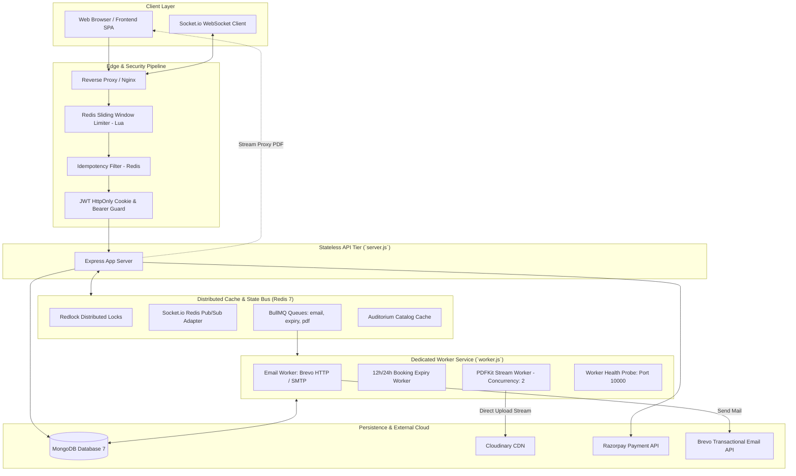

<div align="center">

  # 🏛️ AuditoReserve
  ### *Enterprise-Grade Campus Auditorium Reservation & Facility Management Platform*

  [](https://opensource.org/licenses/ISC)
  [](https://nodejs.org/)
  [](https://expressjs.com/)
  [](https://www.mongodb.com/)
  [](https://redis.io/)
  [](https://bullmq.io/)
  [](https://socket.io/)
  [](https://razorpay.com/)
  [](https://cloudinary.com/)
  []()

  <p align="center">
    <b>AuditoReserve</b> is a modern, high-performance auditorium reservation backend engine designed for university campuses. Built with strict role-based access control, distributed concurrency locks, real-time multi-node synchronization, asynchronous background queues, direct-stream Cloudinary PDF receipts, and comprehensive test coverage.
  </p>

  <p align="center">
    <a href="#-key-features">Key Features</a> •
    <a href="#-system-architecture">System Architecture</a> •
    <a href="#-tech-stack">Tech Stack</a> •
    <a href="#-getting-started">Getting Started</a> •
    <a href="#-api-endpoints">API Reference</a> •
    <a href="#-automated-testing">Testing</a> •
    <a href="./ARCHITECTURE.md">Deep-Dive Architecture ↗</a>
  </p>

</div>

---

## 📖 Overview

University auditoriums are high-demand shared resources vulnerable to scheduling collisions, unconfirmed slot hoarding, and administrative bottlenecks. **AuditoReserve** eliminates these issues through:

1. **Conflict-Free Distributed Reservations:** Enforced via **Redis-backed distributed locks (Redlock)** and MongoDB ACID transactions to eliminate double-booking race conditions during concurrent approval and booking windows.
2. **Dual-Tier Asynchronous Workers:** CPU-heavy PDF generation, transactional email delivery, and auto-cancellations (24h pending review and 12h payment deadline) run inside dedicated background **BullMQ** worker processes with an embedded health check server.
3. **Zero-Disk Media & PDF Invoicing Pipeline:** High-resolution PDF receipts stream directly from in-memory Node.js streams into **Cloudinary CDN**, served via proxy streaming directly to clients without third-party CORS redirects or local disk storage.
4. **Horizontal WebSocket Scaling:** Built on `@socket.io/redis-adapter` with a Redis Pub/Sub backplane, enabling real-time push alerts across multiple load-balanced API nodes.
5. **Rock-Solid Security & Idempotency:** Atomic sliding-window rate limiters powered by Redis Lua scripts, cryptographic timing-safe payment signature validation, and per-user idempotency filters.

> 💡 **Looking for low-level architecture designs, concurrency flowcharts, and sequence diagrams?**  
> Check out the [Comprehensive Architecture Specification (ARCHITECTURE.md)](./ARCHITECTURE.md).

---

## ✨ Key Features

### 🎓 Student Experience
- 📅 **Interactive Visual Calendar:** Query availability by venue and month (`/api/bookings/calendar`) with full UTC timezone offset protection.
- 📝 **Collision-Guarded Booking Requests:** Real-time validation preventing time overlaps, past dates, invalid 24h formats, and restricting students to at most 3 active pending requests.
- 💳 **Seamless Razorpay Integration:** Payment orders and cryptographic signature verification with a strictly enforced 12-hour payment window.
- 🧾 **Direct PDF Receipt Downloads:** Download and preview verified payment receipts streamed instantly via Cloudinary.
- 🔔 **Live Push Alerts:** In-app real-time notifications via WebSockets on booking approvals, cancellations, and payment confirmations.

### 🛡️ Administrative Control
- 🏢 **Venue Management (CRUD):** Catalog halls, capacities, amenities, base pricing, and multi-image uploads to Cloudinary with automatic image deletion on update/delete.
- 📑 **Conflict-Guarded Booking Review:** Approve or decline student applications with Redlock concurrency guards and automatic cancellation of competing pending requests.
- 📊 **Operational Queries:** Filter bookings by status and auditorium with clean pagination.
- ⚡ **Automated Slot Expiration:** Auto-releases approved slots back to available inventory if payment is not completed within 12 hours, or if pending requests are unreviewed within 24 hours.

### ⚙️ Core Platform & Engineering
- 🔒 **Distributed Concurrency Guard (Redlock):** Prevents two users or administrators from creating, approving, or verifying conflicting slots simultaneously.
- ⚡ **Resilient Cache-Aside Pattern:** Redis caching for auditorium catalogs with automated cache invalidation on mutations.
- 🔄 **3 Dedicated BullMQ Worker Queues:**
  - `email-queue`: Asynchronous transactional emails (verification, reset passwords, approvals, cancellations) via Brevo HTTP API with Nodemailer SMTP fallback.
  - `booking-expiry`: Delayed jobs enforcing pending request timeouts and the 12-hour payment deadline.
  - `pdf-generation-queue`: Direct stream PDF rendering and Cloudinary CDN synchronization.
- 🌐 **Multi-Instance WebSocket Adapter:** Redis Pub/Sub adapter guarantees notification delivery to user rooms across any API server node.
- 🛡️ **Graceful Process Shutdown:** Intercepts `SIGINT`/`SIGTERM` to allow in-flight BullMQ jobs and active DB/Redis connection pools to terminate safely.
- 🧪 **Enterprise Test Suite:** 21 test suites and 136 automated unit, worker, and integration tests.

---

## 🏗️ System Architecture



---

## 🛠️ Tech Stack

| Layer | Technologies | Purpose |
| :--- | :--- | :--- |
| **Runtime & Framework** | Node.js (v20+) • Express.js 4.21 | High-throughput asynchronous REST API & WebSocket server |
| **Primary Database** | MongoDB 7 • Mongoose 9.6 | Document database with schema validation, compound indexes & sessions |
| **In-Memory Store** | Redis 7 • ioredis 5.10 | Cache-aside, distributed locks (Redlock), rate limiting & BullMQ backend |
| **Job Queues** | BullMQ 5.78 | Redis-backed asynchronous worker queues with delayed jobs & retry policies |
| **Real-time Engine** | Socket.io 4.8 • `@socket.io/redis-adapter` | Multi-node bi-directional WebSocket communication |
| **PDF Generation** | PDFKit 0.20 | Programmatic, high-resolution vector PDF receipt creation |
| **Media & CDN** | Cloudinary SDK • Multer Storage | Cloud image hosting & direct raw PDF stream uploads |
| **Payments** | Razorpay Node SDK 2.9 | Order creation, HMAC-SHA256 timingSafeEqual signature verification |
| **Email Service** | Brevo HTTP API (`v3/smtp/email`) • Nodemailer 8.0 | Dual-provider transactional email system with SMTP fallback |
| **Security & Logging** | Winston 3.19 • Helmet 8.1 • Zod 4.6 • bcryptjs | Structured JSON logging, HTTP security headers, and schema validation |
| **Testing** | Jest 30.5 • Supertest 7.3 • ioredis-mock | Automated unit, integration, worker, and security test suite |

---

## 📂 Directory Structure

```
Auditorium Booking System/
├── 📄 ARCHITECTURE.md          # Comprehensive architectural & sequence documentation
├── 📄 README.md                # Project overview and quickstart guide
│
└── 📁 backend/
    ├── 📁 src/
    │   ├── 📁 config/          # Database, Redis, Cloudinary, Razorpay, Socket & Winston
    │   ├── 📁 controllers/     # Auth, Auditorium, Booking, Payment, Notification handlers
    │   ├── 📁 middlewares/     # JWT Guard, Idempotency, Sliding Rate Limiter, Error, Upload
    │   ├── 📁 models/          # User, Auditorium, Booking, Payment, Notification schemas
    │   ├── 📁 queue/           # BullMQ queue producers (Email, Expiry, PDF)
    │   ├── 📁 routes/          # Express route definitions
    │   ├── 📁 service/         # Email dispatch and in-app Notification services
    │   ├── 📁 utils/           # Cache, Cloudinary helpers, JWT, Redlock, PDFKit generator
    │   ├── 📁 validators/      # Zod validation schemas
    │   ├── 📁 worker/          # BullMQ background workers (emailWorker, bookingExpiryWorker, pdfWorker)
    │   ├── 📄 app.js           # Express app setup, rate limiters, routes & error handling
    │   ├── 📄 server.js        # Express HTTP server & Socket.io bootstrap
    │   └── 📄 worker.js        # Dedicated background worker process with health probe
    │
    ├── 📁 tests/               # 21 test suites & 136 passing tests
    │   ├── 📁 helpers/         # Test authentication helpers and database fixtures
    │   ├── 📁 integration/     # Auth, Auditorium, Booking, Payment, Notification & Concurrency tests
    │   └── 📁 unit/            # Middlewares, Services, Utils, and Worker unit tests
    │
    ├── 📄 Dockerfile           # Multi-stage production container image (Node 20 Alpine)
    ├── 📄 docker-compose.yml   # Multi-service container orchestration (API + Worker)
    ├── 📄 package.json
    └── 📄 .env.example         # Environment template
```

---

## ⚙️ Environment Configuration

Populate `backend/.env` with your credentials:

```env
# Server Configuration
PORT=5000
NODE_ENV=development
FRONTEND_URL=http://localhost:5173
UNIVERSITY_DOMAIN=tmu.ac.in

# Database Configuration
MONGODB_URI=mongodb://localhost:27017/auditoreserve

# Redis Configuration (BullMQ, Distributed Locks, Rate Limiting & Socket.IO)
REDIS_HOST=127.0.0.1
REDIS_PORT=6379
REDIS_PASSWORD=

# JWT Secrets
JWT_ACCESS_SECRET=your_jwt_access_secret_key_here
JWT_REFRESH_SECRET=your_jwt_refresh_secret_key_here

# Email / Brevo Configuration (Primary HTTP API)
BREVO_API_KEY=xkeysib-your_brevo_api_key_here
FROM_EMAIL=notifications@yourdomain.com
FROM_NAME="AuditoReserve Administration"

# Optional SMTP fallback (used if BREVO_API_KEY is omitted)
SMTP_HOST=smtp-relay.brevo.com
SMTP_PORT=587
SMTP_SECURE=false
SMTP_USER=your_smtp_user
SMTP_PASS=your_smtp_password

# Cloudinary Storage Configuration
CLOUDINARY_CLOUD_NAME=your_cloudinary_cloud_name
CLOUDINARY_API_KEY=your_cloudinary_api_key
CLOUDINARY_API_SECRET=your_cloudinary_api_secret

# Razorpay Payment Gateway Configuration
RAZORPAY_KEY_ID=rzp_test_your_razorpay_key_id
RAZORPAY_SECRET_KEY=your_razorpay_secret_key
```

---

## 🏁 Getting Started

### 📋 Prerequisites
- **Node.js**: `v20.0.0` or higher
- **npm**: `v9.0.0` or higher
- **MongoDB**: Local MongoDB community instance or MongoDB Atlas URI
- **Redis**: Local Redis server or Redis Cloud instance

---

### 🐳 Running with Docker Compose

AuditoReserve includes a container setup in `backend/docker-compose.yml` that orchestrates both the **API Server** and the **Background Worker** services:

```bash
cd backend

# Build and launch both API and Worker containers in detached mode
docker compose up -d --build

# Verify running services
docker compose ps

# View live API logs
docker compose logs -f api

# View live background worker logs
docker compose logs -f worker

# Stop containers
docker compose down
```

---

### ⚡ Manual Local Development Setup

1. **Clone the repository**
   ```bash
   git clone https://github.com/buildwithrishabh/AuditoReserve.git
   cd "Auditorium Booking System/backend"
   ```

2. **Install Dependencies**
   ```bash
   npm install
   ```

3. **Configure Environment**
   ```bash
   cp .env.example .env
   # Edit .env with your MongoDB, Redis, Cloudinary, and Razorpay credentials
   ```

4. **Start Application**
   ```bash
   # Run API server with nodemon auto-restart:
   npm run dev

   # In a separate terminal, run background worker:
   npm run dev:worker
   ```

5. **Verify Readiness**
   - **API Health Check:** [http://localhost:5000/api/health](http://localhost:5000/api/health)
   - **Worker Health Probe:** [http://localhost:10000](http://localhost:10000)

---

## 🔌 API Endpoints

### 🔐 Authentication (`/api/auth`)
| Method | Endpoint | Access | Rate Limit | Description |
| :--- | :--- | :--- | :--- | :--- |
| `POST` | `/api/auth/register` | Public | 5 req / 15m | Register student (domain verified) & enqueue verification email |
| `GET` | `/api/auth/verify-email` | Public | — | Verify email using cryptographic SHA-256 token |
| `POST` | `/api/auth/resend-verification` | Public | 5 req / 15m | Re-dispatch verification email |
| `POST` | `/api/auth/login` | Public | 10 req / 15m | Authenticate credentials & issue HttpOnly JWT cookies |
| `POST` | `/api/auth/refresh` | Public | 30 req / 15m | Rotate refresh token & issue new access token |
| `POST` | `/api/auth/logout` | Authenticated | — | Revoke refresh token in database & clear auth cookies |
| `POST` | `/api/auth/forget-password` | Public | 5 req / 15m | Dispatch password reset email with 10-minute token |
| `POST` | `/api/auth/reset-password/:token` | Public | 5 req / 15m | Reset password via token |
| `GET` | `/api/auth/me` | Authenticated | — | Retrieve authenticated user profile |

### 🏛️ Auditoriums (`/api/auditoriums`)
| Method | Endpoint | Access | Rate Limit | Description |
| :--- | :--- | :--- | :--- | :--- |
| `GET` | `/api/auditoriums/viewAllAuditoriums` | Public | 60 req / 1m | List all venues (Redis cached, 5m TTL) |
| `GET` | `/api/auditoriums/viewAuditorium/:id` | Public | 60 req / 1m | Get single auditorium details (Redis cached) |
| `POST` | `/api/auditoriums/createAuditorium` | Admin | 10 req / 1m | Create venue with up to 5 Cloudinary images |
| `PUT` | `/api/auditoriums/updateAuditorium/:id`| Admin | 10 req / 1m | Update venue, purge cache & clean replaced images |
| `DELETE`| `/api/auditoriums/deleteAuditorium/:id`| Admin | — | Remove venue (guarded against active bookings) |

### 📅 Bookings (`/api/bookings`)
| Method | Endpoint | Access | Rate Limit | Description |
| :--- | :--- | :--- | :--- | :--- |
| `GET` | `/api/bookings/calendar` | Student/Admin | 60 req / 1m | Fetch confirmed/approved bookings by month (YYYY-MM) |
| `POST` | `/api/bookings/createBooking` | Student | 5 req / 1m | Submit reservation (Redlock guarded, max 3 active pending) |
| `GET` | `/api/bookings/my-bookings` | Student | 30 req / 1m | List personal bookings with pagination & filters |
| `PUT` | `/api/bookings/cancel/:id` | Student | 10 req / 1m | Cancel pending/approved reservation & cleanup jobs |
| `GET` | `/api/bookings/all` | Admin | — | List all booking requests with status & auditorium filters |
| `PUT` | `/api/bookings/status/:id` | Admin | — | Approve or decline request (Redlock & transaction guarded) |

### 💳 Payments & Receipts (`/api/payments`)
| Method | Endpoint | Access | Rate Limit | Description |
| :--- | :--- | :--- | :--- | :--- |
| `POST` | `/api/payments/create-order/:bookingId` | Student | 6 req / 1m | Generate Razorpay order for approved booking |
| `POST` | `/api/payments/verify` | Student | 6 req / 1m | Verify HMAC-SHA256 signature (Idempotency-Key required) |
| `GET` | `/api/payments/:bookingId/receipt` | Authenticated | 20 req / 1m | Fetch receipt JSON or inline PDF (`?format=pdf`) |
| `GET` | `/api/payments/:bookingId/receipt/download` | Authenticated | 10 req / 1m | Fast-path proxy stream of Cloudinary CDN PDF |

### 🔔 Notifications (`/api/notifications`)
| Method | Endpoint | Access | Rate Limit | Description |
| :--- | :--- | :--- | :--- | :--- |
| `GET` | `/api/notifications` | Authenticated | 60 req / 1m | Fetch paginated notifications for current user |
| `GET` | `/api/notifications/unread-count` | Authenticated | 60 req / 1m | Get unread notification badge count |
| `PATCH`| `/api/notifications/read-all` | Authenticated | 30 req / 1m | Mark all notifications as read |
| `PATCH`| `/api/notifications/:id` | Authenticated | 30 req / 1m | Mark individual notification as read |
| `DELETE`| `/api/notifications/:id` | Authenticated | 30 req / 1m | Delete notification by ID |

---

## 🧪 Automated Testing

AuditoReserve features a comprehensive test suite covering unit, integration, worker, and security layers:

```bash
cd backend

# Run all test suites
npm test

# Run tests with code coverage analysis
npm run test:coverage
```

### Test Suite Highlights:
- **136 Passing Tests** across **21 Test Suites**.
- **Concurrency & Race Conditions:** Verifies that concurrent admin approvals for colliding slots reject with 400/409, and concurrent payment verifications with identical idempotency keys reject gracefully.
- **Security & Privilege Escalation:** Verifies protection against role manipulation on registration, forged JWT signatures, expired tokens, and NoSQL injection objects.
- **Worker Simulation:** Unit tests verify that `bookingExpiryWorker` cleans up pending and approved records, retries on distributed lock contention, and enqueues cancellation emails.

---

## 🤝 Contributing

1. Fork the repository
2. Create your feature branch (`git checkout -b feature/AmazingFeature`)
3. Ensure all tests pass (`npm test`)
4. Commit your changes (`git commit -m 'feat: Add AmazingFeature'`)
5. Push to the branch (`git push origin feature/AmazingFeature`)
6. Open a Pull Request

---

## 📄 License & Author

Distributed under the **ISC License**.

Created & Maintained with ❤️ by **Rishabh Kumar**  
- **GitHub:** [@buildwithrishabh](https://github.com/buildwithrishabh)
