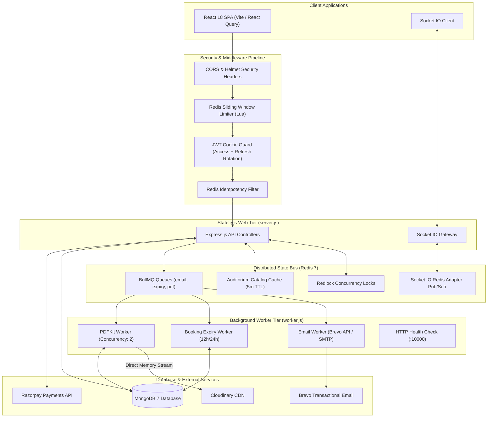

# AuditoReserve

> Institutional campus auditorium reservation and facility lifecycle management platform with distributed concurrency control, real-time event distribution, and asynchronous background processing.

[](https://opensource.org/licenses/ISC)
[](https://nodejs.org/)
[](https://expressjs.com/)
[](https://react.dev/)
[](https://www.mongodb.com/)
[](https://redis.io/)
[](https://bullmq.io/)
[](https://socket.io/)
[]()

---

## Overview

University auditoriums, conference halls, and seminar venues are high-demand campus resources that frequently suffer from double-booking race conditions, unconfirmed slot hoarding, administrative friction, and untracked manual payments.

**AuditoReserve** is a full-stack platform built specifically to resolve these operational bottlenecks:
- **Zero Double-Bookings:** Enforces distributed locking via Redis (`Redlock`) and MongoDB ACID multi-document transactions during reservation creation, review, and payment confirmation.
- **Automated Slot Recapture:** Frees unreviewed booking requests after 24 hours and revokes unpaid approvals after 12 hours using BullMQ delayed job schedulers.
- **Zero-Disk Media Pipeline:** Generates branded PDF tax receipts directly into Cloudinary CDN via Node.js memory streams, shielding application servers from disk saturation.
- **Cross-Node Live Updates:** Propagates real-time approval status badges, payment notifications, and calendar bookings across multiple server instances via `@socket.io/redis-adapter`.
- **Institutional Trust & Security:** Restricts student registration to verified university email domains (`@tmu.ac.in`), safeguards authentication via HttpOnly token rotation, and prevents replay attacks through atomic Redis sliding-window rate limiters.

---

## Key Features

### Student Experience
- **Interactive Venue Discovery:** Filter auditoriums by capacity, facilities, pricing, and visual photo galleries with fast-loading Redis cache-aside reads.
- **Availability Calendar:** Inspect confirmed and approved reservations month-by-month (`/api/bookings/calendar`) to find free slots.
- **Collision-Guarded Requests:** Book venues with date, start time, end time, and event description validations; limited to a maximum of 3 concurrent pending requests per student.
- **In-App Razorpay Checkout:** Secure payment initiation with 12-hour expiration timer countdown and cryptographic HMAC-SHA256 signature verification.
- **Direct Receipt Downloads:** Stream vector-rendered PDF payment invoices directly through secure CDN proxy streams (`/api/payments/:bookingId/receipt/download`).
- **Live WebSocket Notifications:** Instant push alerts for review decisions, payment receipts, and automated cancellations.

### Administrative Governance
- **Venue Lifecycle (CRUD):** Catalog halls, update specifications, and upload up to 5 high-resolution venue photos directly to Cloudinary with automatic cleanup of replaced assets.
- **Conflict-Guarded Approval Workflow:** Approve or reject applications under distributed locks, automatically invalidating competing overlapping requests.
- **Operational Auditing:** Paginated, status-filtered, and venue-filtered reservation oversight.
- **Automated Deadline Expiry:** Background workers clean expired pending requests (24h) and unfulfilled payments (12h) without manual intervention.

### Platform Architecture & Resilience
- **Decoupled Worker Topology:** Isolates CPU-intensive PDF generation, email dispatches, and delayed cron-like expiry monitors in a standalone `worker.js` process.
- **Worker Health Probe:** Embedded micro-HTTP probe on port `10000` enables Kubernetes/Docker container health monitoring.
- **Sliding-Window Rate Limiting:** Atomic Redis Lua script prevents burst flooding across authentication, booking creation, and payment verification endpoints.
- **Graceful Process Teardown:** Handles `SIGINT` and `SIGTERM` signals by completing active jobs, closing Socket.IO connections, draining BullMQ queues, and terminating database connection pools cleanly.

---

## Architecture

The system employs a decoupled, multi-process topology:
1. **Stateless API & Real-Time Gateway (`server.js`):** Ingests client HTTP traffic, enforces security middleware, coordinates distributed locks, and synchronizes WebSocket rooms via Redis Pub/Sub.
2. **Dedicated Background Worker Engine (`worker.js`):** Consumes BullMQ queues (`email-queue`, `booking-expiry`, `pdf-generation-queue`) independently of the web event loop.
3. **Distributed State & In-Memory Mesh (Redis 7):** Serves as the central bus for distributed locks, caching, queue state, sliding-window rate limit counters, and Socket.IO cluster broadcast.
4. **Data Persistence (MongoDB 7):** Stores relational documents with compound uniqueness indexes and supports ACID multi-document transactions.



For complete sequence diagrams, transaction flowcharts, and component breakdowns, see [docs/ARCHITECTURE.md](./docs/ARCHITECTURE.md).

---

## Tech Stack

### Backend
- **Runtime:** Node.js (>= 20.0.0)
- **Framework:** Express.js 4.21
- **Real-Time Mesh:** Socket.IO 4.8 with `@socket.io/redis-adapter` 8.3
- **Background Jobs:** BullMQ 5.78
- **Document Generation:** PDFKit 0.20
- **Validation:** Zod 4.6
- **Logging & Security:** Winston 3.19, Helmet 8.1, bcryptjs 3.0, cookie-parser 1.4

### Frontend
- **Framework:** React 18.3 with Vite 6.0
- **Data Fetching:** TanStack React Query 5.66
- **Routing:** React Router DOM 7.1
- **Icons & Styling:** Lucide React 0.468, Vanilla CSS (Design-system tokens)
- **HTTP & Sockets:** Axios 1.7, Socket.IO Client 4.8

### Database & Storage
- **Primary Database:** MongoDB 7.0 via Mongoose 9.6 (Compound indexes, ACID sessions)
- **In-Memory Store:** Redis 7.0 via ioredis 5.10 (Distributed locking, sliding-window rate limit scripts, cache-aside, pub/sub)
- **Media & File Storage:** Cloudinary SDK 1.41 with Multer Storage Cloudinary 4.0

### Infrastructure & External Services
- **Containerization:** Docker multi-stage builds (`Dockerfile`, `docker-compose.yml`)
- **Payment Processing:** Razorpay Node SDK 2.9 (Order generation, HMAC-SHA256 signature verification)
- **Email Delivery:** Brevo HTTP API (`v3/smtp/email`) with Nodemailer 8.0 SMTP fallback
- **Testing:** Jest 30.5, Supertest 7.3, ioredis-mock 8.13

---

## How the System Works

### 1. User Registration & Domain Verification
1. The student submits their name, university email, and password.
2. The system verifies that the email domain strictly matches `UNIVERSITY_DOMAIN` (e.g., `@tmu.ac.in`).
3. An unhashed 32-byte cryptographically random token is generated, while its SHA-256 hash is saved to MongoDB with a 24-hour expiration.
4. An activation job is enqueued to `email-queue` and delivered via Brevo HTTP API.
5. The student clicks the activation link (`/api/auth/verify-email?token=...`), which hashes the incoming token, locates the user record, and flips `isVerified: true`.

### 2. Booking Submission & Concurrency Control
1. The student submits an auditorium reservation specifying a future date and time window.
2. Input is validated against a 24-hour time format, non-past date, and non-overlapping window constraints.
3. The server acquires a **Redlock distributed lock** keyed by `lock:auditorium:<auditoriumId>:<date>` for 10 seconds.
4. The system asserts that the student has fewer than 3 active `pending` requests and that no existing booking is `approved`, `confirmed`, or pending for overlapping hours.
5. The booking is inserted with status `pending`, and a 24-hour delayed cancellation job is enqueued into `booking-expiry`.

### 3. Administrative Review & Auto-Cancellation
1. An administrator reviews the booking at `/api/bookings/status/:id`.
2. Under a Redlock distributed lock, an **ACID MongoDB transaction** updates the reservation status to `approved` and populates a 12-hour payment deadline (`paymentDeadline = now + 12 hours`).
3. The transaction automatically scans for all other competing `pending` requests for the same hall and overlapping time slots, setting their statuses to `cancelled` with the reason `"Slot approved for another booking"`.
4. The 24-hour pending expiry job is removed, and a new 12-hour payment deadline job is scheduled in `booking-expiry`.
5. An approval notification and transactional email are dispatched asynchronously.

### 4. Payment Verification & Zero-Disk PDF Generation
1. The student initiates Razorpay checkout via `/api/payments/create-order/:bookingId`. The server checks that the payment deadline has not elapsed.
2. The student completes payment in the browser, returning `razorpay_order_id`, `razorpay_payment_id`, and `razorpay_signature`.
3. The client submits verification to `/api/payments/verify` with a mandatory `Idempotency-Key` header.
4. The server cryptographically validates the signature using `crypto.timingSafeEqual`.
5. Under a Redlock distributed lock and an ACID database session:
   - The booking transitions from `approved` to `confirmed`.
   - The payment record status transitions to `completed`.
   - The 12-hour delayed expiry job is removed from `booking-expiry`.
6. A background job is dispatched to `pdf-generation-queue`. The worker renders a vector PDF invoice via PDFKit, streaming chunks directly into Cloudinary without saving files to the host disk.
7. Upon upload completion, the Cloudinary asset URL is persisted to the payment document, and a Socket.IO push notification is delivered to the student.

---

## Project Structure

```text
Auditorium Booking System/
├── package.json              # Monorepo orchestration scripts (dev, build, test)
├── README.md                 # Primary system documentation & quickstart
├── docs/                     # In-depth technical specifications
│   ├── ARCHITECTURE.md       # Deep architectural specifications & sequence flows
│   ├── API.md                # Comprehensive API endpoint & parameter reference
│   ├── SECURITY.md           # Threat model, authentication & encryption protocols
│   └── DESIGN-DECISIONS.md   # Architectural trade-offs & design rationales
│
├── backend/                  # Node.js Express backend & BullMQ worker
│   ├── src/
│   │   ├── config/           # Database, Redis, Cloudinary, Razorpay, Socket.IO & Winston
│   │   ├── controllers/      # Route controllers (Auth, Auditorium, Booking, Payment, Notification)
│   │   ├── middlewares/      # Rate limiter (Lua), Idempotency, JWT guard, Role guard, Upload
│   │   ├── models/           # Mongoose schemas (User, Auditorium, Booking, Payment, Notification)
│   │   ├── queue/            # BullMQ producers (emailQueue, bookingExpiryQueue, pdfQueue)
│   │   ├── routes/           # REST API endpoints
│   │   ├── service/          # Brevo/SMTP email delivery and notification dispatcher
│   │   ├── utils/            # Redlock, Redis cache, PDF generator, Cloudinary helpers
│   │   ├── validators/       # Zod request validation schemas
│   │   ├── worker/           # Background workers (emailWorker, bookingExpiryWorker, pdfWorker)
│   │   ├── app.js            # Express application bootstrap & route mounting
│   │   ├── server.js         # HTTP + Socket.IO server entry point
│   │   └── worker.js         # Standalone BullMQ worker entry point + health probe (:10000)
│   ├── tests/                # 21 test suites & 136 passing tests
│   │   ├── helpers/          # Test fixtures and JWT authentication mocks
│   │   ├── integration/      # Auth, Auditorium, Booking, Payment, Notification API tests
│   │   └── unit/             # Worker, Redlock, Cache, and Middleware unit tests
│   ├── Dockerfile            # Multi-stage production container image
│   ├── docker-compose.yml    # Dual-service composition (API + Worker)
│   └── .env.example          # Backend environment template
│
└── frontend/                 # React 18 + Vite client application
    ├── src/
    │   ├── components/       # UI components (Navbar, Modals, ReceiptModal, Notifications)
    │   ├── context/          # AuthContext (token rotation) and SocketContext (realtime)
    │   ├── pages/            # Student Dashboard, Admin Panel, Booking, Auth pages
    │   ├── services/         # Axios API clients with automatic refresh token interceptors
    │   ├── styles.css        # Design tokens, typography, and responsive styles
    │   └── main.jsx          # Vite React entry point
    ├── public/               # Static assets & brand icons
    ├── vercel.json           # Frontend SPA rewrite rules for production
    └── vite.config.js        # Vite bundler configuration
```

---

## Getting Started

### Prerequisites
- **Node.js**: `>= 20.0.0`
- **npm**: `>= 9.0.0`
- **MongoDB**: Community Server `>= 7.0` (Replica set recommended for transactions) or MongoDB Atlas URI
- **Redis**: Server `>= 7.0` (Local or Redis Cloud)
- **External Accounts (Optional for local testing, required for full feature operation):**
  - [Cloudinary](https://cloudinary.com/) (Image uploads & PDF storage)
  - [Razorpay](https://razorpay.com/) (Test mode keys for booking checkout)
  - [Brevo](https://www.brevo.com/) (Transactional email delivery)

---

### Installation

Clone the repository and install root, backend, and frontend dependencies:

```bash
# Clone the repository
git clone https://github.com/buildwithrishabh/AuditoReserve.git
cd "Auditorium Booking System"

# Install backend dependencies
cd backend && npm install

# Install frontend dependencies
cd ../frontend && npm install

# Return to project root
cd ..
```

---

### Environment Variables

#### Backend Configuration (`backend/.env`)

Copy `backend/.env.example` to `backend/.env` and update the values:

```bash
cp backend/.env.example backend/.env
```

| Variable | Required | Description | Example |
| :--- | :--- | :--- | :--- |
| `PORT` | Yes | HTTP API server port | `5000` |
| `NODE_ENV` | Yes | Application environment | `development` |
| `FRONTEND_URL` | Yes | Frontend client origin for CORS and cookies | `http://localhost:5173` |
| `UNIVERSITY_DOMAIN` | Yes | Allowed domain for student registration | `tmu.ac.in` |
| `MONGODB_URI` | Yes | MongoDB connection string | `mongodb://127.0.0.1:27017/auditoreserve` |
| `REDIS_HOST` | Yes | Redis host | `127.0.0.1` |
| `REDIS_PORT` | Yes | Redis port | `6379` |
| `REDIS_PASSWORD` | No | Redis password (leave blank for local development) | `""` |
| `JWT_ACCESS_SECRET` | Yes | Secret for 15-minute access tokens | `min_32_chars_random_secret` |
| `JWT_REFRESH_SECRET` | Yes | Secret for 7-day refresh tokens | `min_32_chars_random_secret` |
| `BREVO_API_KEY` | Optional* | Brevo HTTP API key for transactional emails | `xkeysib-...` |
| `FROM_EMAIL` | Optional* | Sender email address | `notifications@yourdomain.com` |
| `FROM_NAME` | Optional* | Sender display name | `AuditoReserve` |
| `SMTP_HOST` | Optional* | Fallback SMTP host | `smtp-relay.brevo.com` |
| `SMTP_PORT` | Optional* | Fallback SMTP port | `587` |
| `SMTP_USER` | Optional* | Fallback SMTP username | `your_smtp_user` |
| `SMTP_PASS` | Optional* | Fallback SMTP password | `your_smtp_password` |
| `CLOUDINARY_CLOUD_NAME` | Optional* | Cloudinary cloud identifier | `your_cloud_name` |
| `CLOUDINARY_API_KEY` | Optional* | Cloudinary API key | `123456789012345` |
| `CLOUDINARY_API_SECRET` | Optional* | Cloudinary API secret | `your_secret` |
| `RAZORPAY_KEY_ID` | Optional* | Razorpay API key ID | `rzp_test_...` |
| `RAZORPAY_SECRET_KEY` | Optional* | Razorpay API secret key | `your_secret` |

*\* Note: In local development, if external credentials are not set, mock mode or local fallbacks are applied for test suites.*

#### Frontend Configuration (`frontend/.env`)

Copy `frontend/.env.example` to `frontend/.env`:

```bash
cp frontend/.env.example frontend/.env
```

| Variable | Required | Description | Example |
| :--- | :--- | :--- | :--- |
| `VITE_API_URL` | Yes | Backend REST API endpoint URL | `http://localhost:5000/api` |
| `VITE_SOCKET_URL` | Yes | Backend Socket.IO server base URL | `http://localhost:5000` |

---

### Running Locally

You can launch all services using the root orchestration scripts or individual terminals:

#### Method A: Root NPM Scripts (Recommended)

Open 3 terminal windows from the repository root:

```bash
# Terminal 1: Run Express REST API & Socket.IO server
npm run dev:backend

# Terminal 2: Run BullMQ background workers (email, expiry, PDF)
npm run dev:worker

# Terminal 3: Run Vite Frontend SPA
npm run dev:frontend
```

#### Method B: Direct Directory Launch

```bash
# Start API Server (Runs on http://localhost:5000)
cd backend && npm run dev

# Start Background Worker (Health check probe on http://localhost:10000)
cd backend && npm run dev:worker

# Start Frontend (Runs on http://localhost:5173)
cd frontend && npm run dev
```

#### Verification Endpoints
- **API Health Check:** `http://localhost:5000/api/health`
- **Worker Health Probe:** `http://localhost:10000`
- **Frontend Web UI:** `http://localhost:5173`

---

## Docker

The project includes production-ready containerization in `backend/`:
- `backend/Dockerfile`: Multi-stage Alpine build that can serve as either the API server or the background worker based on container entrypoint commands.
- `backend/docker-compose.yml`: Launches both the API and Worker containers with isolated responsibilities:

```bash
cd backend

# Build and start both API and Worker containers in the background
docker compose up -d --build

# Inspect container status
docker compose ps

# View live API logs
docker compose logs -f api

# View live worker logs
docker compose logs -f worker

# Tear down containers
docker compose down
```

---

## API Overview

The backend exposes a structured REST API under the `/api` namespace:

| Module | Base Path | Description | Access | Rate Limit |
| :--- | :--- | :--- | :--- | :--- |
| **Auth** | `/api/auth` | Registration, email activation, session refresh, and password recovery | Public / User | 5–30 req / 15m |
| **Auditoriums** | `/api/auditoriums` | Venue catalog, room details, and administrative CRUD | Public / Admin | 10–60 req / 1m |
| **Bookings** | `/api/bookings` | Availability calendar, booking creation, cancellation, and admin review | Student / Admin | 5–60 req / 1m |
| **Payments** | `/api/payments` | Razorpay order creation, signature verification, and PDF invoice downloads | Student / User | 6–20 req / 1m |
| **Notifications** | `/api/notifications` | Paginated notification inbox, unread badge counter, and read receipts | Authenticated | 30–60 req / 1m |
| **Health** | `/api/health` | System liveness probe returning uptime, memory, and UTC timestamp | Public | — |

👉 **For the complete endpoint specifications, JSON request/response payloads, and error codes, refer to [docs/API.md](./docs/API.md).**

---

## Security

AuditoReserve implements defense-in-depth principles across transport, authentication, database, and process boundaries:

- **Token Storage & Rotation:** 15-minute access tokens are held in frontend memory (React state), never in browser `localStorage`. 7-day refresh tokens are stored in `HttpOnly`, `SameSite=Lax`, `Secure` cookies with SHA-256 database hashing and automatic token family revocation upon reuse detection.
- **Sliding-Window Rate Limiting:** Implemented via an atomic Redis Lua script (`ZREMRANGEBYSCORE` + `ZADD` + `EXPIRE`), preventing burst-window evasion.
- **Timing-Safe Cryptography:** Razorpay webhook/payment signatures are evaluated via `crypto.timingSafeEqual` to prevent side-channel timing attacks.
- **Domain Verification:** Enforces strict domain checking on email registration to restrict access to authenticated university faculty and students.
- **Payload Validation & Sanitization:** Strict Zod validation schemas intercept malicious or malformed parameters before reaching controller handlers.
- **Distributed Lock Security:** Redlock distributed locks release via atomic Lua scripts checking instance ownership tokens, preventing race condition deadlocks.

👉 **For the complete threat model and security architecture, see [docs/SECURITY.md](./docs/SECURITY.md).**

---

## Scalability

AuditoReserve is designed for independent horizontal scaling:

- **Decoupled Worker Scaling:** The `worker.js` process operates independently from `server.js`. Heavy jobs like PDF rendering and batch email dispatches can be scaled to dedicated worker nodes without degrading API latency.
- **Multi-Node WebSocket Sync:** `@socket.io/redis-adapter` distributes Socket.IO events across any number of Express API instances using Redis Pub/Sub channels.
- **Cache-Aside Pattern:** Venue details and lists are served directly from Redis with a 5-minute TTL, drastically reducing MongoDB read contention. Mutations automatically purge affected keys.
- **Database Optimization:** MongoDB compound indexes (`auditorium + date + startTime + endTime`, `student + status`, `user + isRead`) optimize frequent queries and prevent full table scans.

---

## Testing

The backend includes a comprehensive automated test suite built with Jest, Supertest, and `ioredis-mock`:

```bash
cd backend

# Execute all test suites
npm test

# Run tests with code coverage report
npm run test:coverage
```

### Coverage Scope:
- **136 automated tests** across **21 test suites**.
- **Unit Tests:** Validates middleware (JWT auth, rate limiting, error formatting, idempotency), utilities (Redlock, cache-aside, receipt generator), and BullMQ worker processors.
- **Integration Tests:** Verifies end-to-end flows for `/api/auth`, `/api/auditoriums`, `/api/bookings`, `/api/payments`, and `/api/notifications`.
- **Concurrency Tests:** Verifies distributed lock behavior during simulated concurrent admin approvals and parallel payment verification attempts.

---

## Deployment

### Frontend Deployment (Vercel / Cloudflare Pages)
The React application contains a production configuration in `frontend/vercel.json` configured for Single Page Application client-side routing rewrites:
```json
{
  "rewrites": [{ "source": "/(.*)", "destination": "/index.html" }]
}
```
Set `VITE_API_URL` and `VITE_SOCKET_URL` in your hosting dashboard to point to the production backend URL.

### Backend & Worker Deployment (Docker / Cloud PaaS)
Deploy the backend as two independent container services:
1. **API Web Service:** Executes `npm run start:api` (or `node src/server.js`), exposed via port `5000` behind an HTTPS reverse proxy (e.g., Nginx, AWS ALB, Render).
2. **Background Worker Service:** Executes `npm run start:worker` (or `node src/worker.js`), with internal port `10000` configured as a private liveness health check probe.

Both services require access to the shared MongoDB cluster and Redis instance.

---

## Documentation

For detailed architectural diagrams, API contracts, threat models, and engineering rationale, explore the project documentation:

- 🏛️ **[Architecture Guide (docs/ARCHITECTURE.md)](./docs/ARCHITECTURE.md):** Process topologies, sequence workflows, and subsystem deep-dives.
- 🔌 **[API Reference (docs/API.md)](./docs/API.md):** Complete HTTP route catalog, headers, parameters, and status responses.
- 🛡️ **[Security Architecture (docs/SECURITY.md)](./docs/SECURITY.md):** Threat modeling, cryptographic signature validation, and authentication guarantees.
- 📐 **[Design Decisions (docs/DESIGN-DECISIONS.md)](./docs/DESIGN-DECISIONS.md):** Engineering trade-offs, concurrency models, and architecture rationales.

---

## Screenshots / Demo

The frontend is an institutional booking product featuring:
- **Venue Directory:** Grid and card views of campus auditoriums with capacity, pricing, and visual photo carousels.
- **Booking Management:** Live status tracker for submitted reservation requests (Pending, Approved, Confirmed, Cancelled).
- **Payment Portal:** Razorpay modal checkout with real-time countdown timer.
- **Receipt Modal:** In-app preview and direct PDF download for confirmed payments.
- **Notification Drawer:** Real-time push notification center with unread counters.

*(Screenshots can be added here once UI captures are uploaded).*

---

## Future Improvements

The following improvements are planned based on current system capabilities:
- **Multi-Node Redlock Consensus:** Expand from single-instance Redis distributed locking to a 3-node or 5-node Redlock cluster for full distributed fault tolerance.
- **Razorpay Webhook Handler:** Implement an asynchronous `/api/payments/webhook` endpoint with signature validation to guarantee payment confirmation even if the student closes their browser prior to frontend redirection.
- **Recurring Reservations:** Support weekly/monthly recurring reservations for recurring university lectures and student society chapters.
- **Departmental Budget Codes:** Allow campus departments to charge venue reservations directly to institutional cost centers.

---

## License

This project is licensed under the **ISC License**.

Created & Maintained by **Rishabh Kumar**  
GitHub: [@buildwithrishabh](https://github.com/buildwithrishabh)
