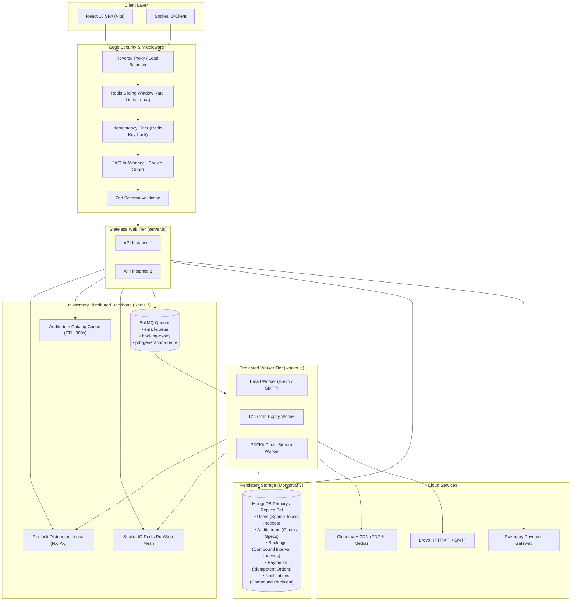
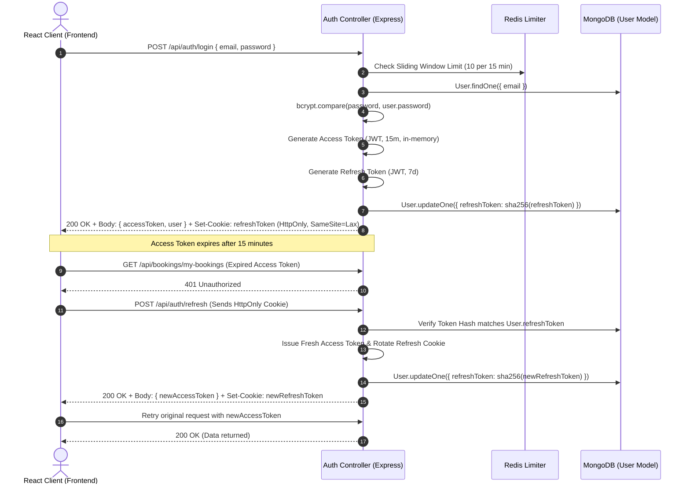
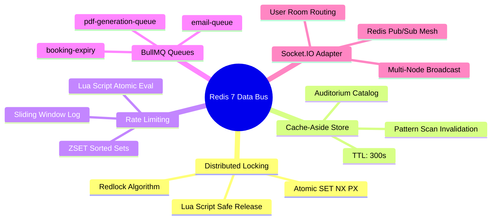
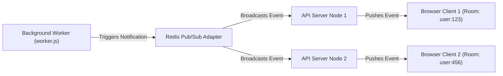
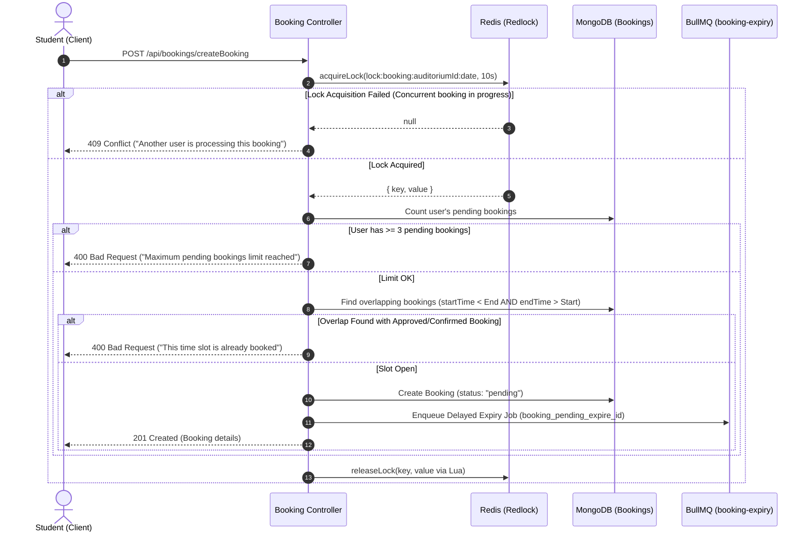
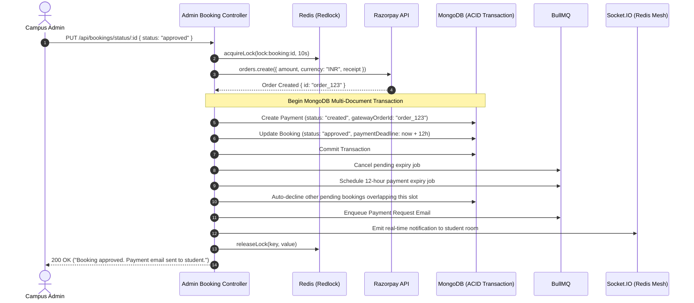
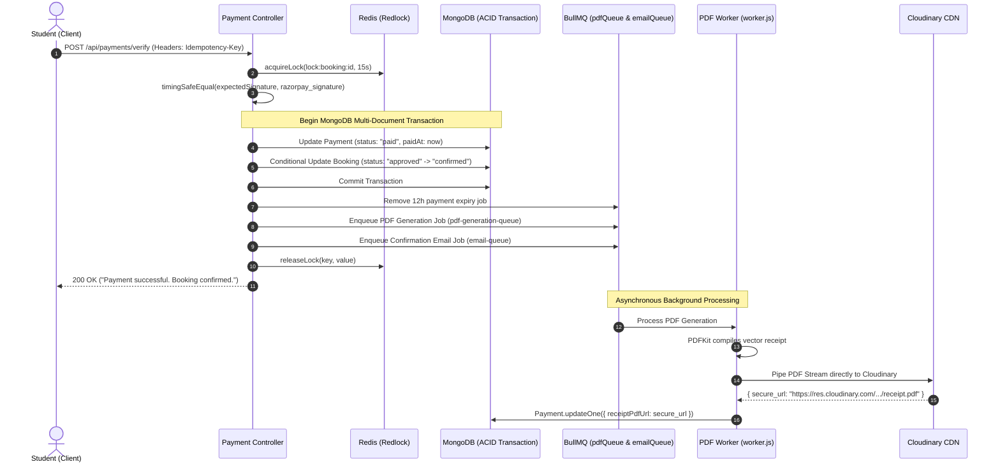

# 🏛️ AuditoReserve — Deep Technical Architecture

This document provides a comprehensive technical breakdown of the **AuditoReserve** campus facilities reservation platform. It details the runtime process models, concurrency control mechanisms, distributed transactions, asynchronous job pipelines, and fault-tolerance topologies implemented in the codebase.

---

## 📌 Table of Contents

- [1. System Overview & Process Topology](#1-system-overview--process-topology)
- [2. End-to-End System Architecture Diagram](#2-end-to-end-system-architecture-diagram)
- [3. Component Responsibilities](#3-component-responsibilities)
- [4. HTTP Request Lifecycle & Middleware Pipeline](#4-http-request-lifecycle--middleware-pipeline)
- [5. Authentication & Session Architecture](#5-authentication--session-architecture)
- [6. Database Architecture & Index Topologies](#6-database-architecture--index-topologies)
- [7. Redis Multi-Role Architecture](#7-redis-multi-role-architecture)
- [8. Asynchronous Queue & Worker Architecture (BullMQ)](#8-asynchronous-queue--worker-architecture-bullmq)
- [9. Real-Time WebSocket Mesh (Socket.IO + Redis Adapter)](#9-real-time-websocket-mesh-socketio--redis-adapter)
- [10. External Service Integrations](#10-external-service-integrations)
- [11. Core Business Workflows & Sequence Diagrams](#11-core-business-workflows--sequence-diagrams)
- [12. Distributed Concurrency & Locking (Redlock)](#12-distributed-concurrency--locking-redlock)
- [13. Idempotency Architecture](#13-idempotency-architecture)
- [14. Caching Strategy (Cache-Aside Pattern)](#14-caching-strategy-cache-aside-pattern)
- [15. Multi-Document ACID Transactions](#15-multi-document-acid-transactions)
- [16. Retry, Failure Handling & Graceful Shutdown](#16-retry-failure-handling--graceful-shutdown)
- [17. Observability & Logging](#17-observability--logging)
- [18. Scaling Strategy](#18-scaling-strategy)
- [19. Failure Scenarios & Self-Healing Analysis](#19-failure-scenarios--self-healing-analysis)
- [20. Technical Limitations & Trade-Offs](#20-technical-limitations--trade-offs)

---

## 1. System Overview & Process Topology

AuditoReserve separates synchronous user-facing I/O from asynchronous background workloads by partitioning the backend into two decoupled Node.js processes:

1. **API & Real-Time Gateway (`backend/src/server.js`)**:
   - Manages incoming HTTP/REST requests via Express.js.
   - Enforces distributed rate limiting, authentication, and validation.
   - Manages persistent WebSocket connections with `@socket.io/redis-adapter` for horizontal real-time message broadcasting.
   - Enqueues heavy background jobs into Redis queues without executing them in the main process.

2. **Dedicated Background Worker Process (`backend/src/worker.js`)**:
   - Connects to MongoDB and Redis to poll BullMQ worker queues.
   - Executes CPU-heavy tasks: streaming PDF generation via PDFKit, transactional emails via Brevo/SMTP, and delayed booking expirations.
   - Includes a lightweight HTTP probe server on port 10000 to satisfy platform health probes on containerized PaaS environments (e.g. Render).

---

## 2. End-to-End System Architecture Diagram



---

## 3. Component Responsibilities

| Subsystem | Entry Point | Architectural Role | Dependencies |
| :--- | :--- | :--- | :--- |
| **API Server** | `src/server.js` | Express HTTP ingress, request routing, validation, distributed lock acquisition, response delivery. | Express, Helmet, CORS, Morgan |
| **Worker Engine** | `src/worker.js` | Independent worker listening to BullMQ queues; executes PDF compilation, email dispatch, delayed expirations. | BullMQ, PDFKit, Cloudinary, Brevo |
| **Real-Time Gateway** | `src/config/socket.js` | Socket.IO server mounted on HTTP server; synchronizes user rooms across multi-node clusters using Redis Pub/Sub. | Socket.IO, @socket.io/redis-adapter |
| **Database Tier** | `src/config/db.js` | Persistent MongoDB connection pooling with Mongoose ODM and multi-document transactions. | Mongoose, MongoDB Replica Set |
| **In-Memory Tier** | `src/config/redis.js` | Standalone ioredis client powering distributed locks, cache-aside queries, and rate-limiting scripts. | ioredis |
| **Queue Connection** | `src/config/queueConnection.js` | Dedicated Redis connection for BullMQ with `maxRetriesPerRequest: null`. | ioredis, BullMQ |

---

## 4. HTTP Request Lifecycle & Middleware Pipeline

Every HTTP request traverses a strict, defensive pipeline before invoking business logic:


---

## 5. Authentication & Session Architecture

AuditoReserve utilizes an **in-memory short-lived access token + HttpOnly refresh cookie** pattern:



---

## 6. Database Architecture & Index Topologies

### Schemas & Compound Indexes

#### `Booking` Collection
Stores slot requests, approved schedules, pricing, and lifecycle timestamps.
- **Compound Scheduling Index**:
  ```javascript
  bookingSchema.index({
    auditorium: 1,
    status: 1,
    bookingDate: 1,
    startTime: 1,
    endTime: 1,
  });
  ```
  *Purpose: Accelerates collision detection queries (`$lt` / `$gt`) on overlapping intervals down to sub-millisecond lookups.*
- **Dashboard & User Index**: `{ user: 1, createdAt: -1 }`
- **Admin Recency Index**: `{ createdAt: -1 }`
- **Expiry Polling Index**: `{ status: 1, paymentDeadline: 1 }`

#### `Payment` Collection
Stores financial transaction details, Razorpay references, and receipt metadata.
- **Unique Constraints**: `gatewayOrderId` (unique), `gatewayPaymentId` (unique, sparse), `receipt` (unique).
- **Lookup Indexes**: `{ booking: 1 }`, `{ user: 1, createdAt: -1 }`, `{ status: 1, expiresAt: 1 }`.

#### `User` Collection
Stores accounts, roles (`student`, `admin`), verification tokens, and session token hashes.
- **Sparse Indexes**: `refreshToken: 1`, `verificationToken: 1`, `resetPasswordToken: 1`.

#### `Notification` Collection
Stores notifications and read states.
- **Compound User Feed Index**: `{ recipient: 1, createdAt: -1 }`, `{ recipient: 1, isRead: 1 }`.

---

## 7. Redis Multi-Role Architecture

Redis 7 serves 5 distinct architectural responsibilities in the platform:



---

## 8. Asynchronous Queue & Worker Architecture (BullMQ)

Three dedicated queues decouple heavy background processing from the API server:

### 1. `email-queue`
- **Job Payload**: `{ options: { to, subject, html, text } }`
- **Execution**: `backend/src/worker/emailWorker.js`
- **Strategy**: Dispatches via **Brevo HTTP API** (`https://api.brevo.com/v3/smtp/email`). If API keys are absent or invalid, seamlessly falls back to **Nodemailer SMTP**.
- **Retry Policy**: 3 attempts with exponential backoff (initial delay: 5s).

### 2. `booking-expiry`
- **Job Payload**: `{ bookingId }`
- **Job Key**: `booking_pending_expire_${id}` or `booking_expiry_${id}`
- **Execution**: `backend/src/worker/bookingExpiryWorker.js`
- **Strategy**: Delayed job scheduled for 24h (pending admin review) or 12h (approved payment window).
- **Concurrency Guard**: Acquires `lock:booking:${bookingId}` before altering status to avoid racing with live admin approvals or payment confirmations.

### 3. `pdf-generation-queue`
- **Job Payload**: `{ bookingId, paymentId }`
- **Execution**: `backend/src/worker/pdfWorker.js`
- **Concurrency**: 2 parallel workers.
- **Strategy**: Compiles vector PDF with PDFKit and pipes directly to Cloudinary without local disk storage. Updates `payment.receiptPdfUrl`.

---

## 9. Real-Time WebSocket Mesh (Socket.IO + Redis Adapter)

### Multi-Node Scalability
When multiple API instances run behind a reverse proxy, a WebSocket connection on Node A cannot normally notify a client connected to Node B. AuditoReserve solves this with `@socket.io/redis-adapter`:



### Connection & Authentication Flow
1. Client establishes WebSocket handshake sending JWT access token in `handshake.auth.token` or cookies.
2. Socket middleware verifies JWT using `JWT_ACCESS_SECRET`.
3. The socket joins a private room: `user:${userId}`.
4. Services emit targeted notifications via `sendRealTimeNotification(userId, notification)`.

---

## 10. External Service Integrations

| External Service | Integration Mechanism | Fallback / Redundancy |
| :--- | :--- | :--- |
| **Razorpay** | REST API order creation (`orders.create`) + cryptographic HMAC-SHA256 signature verification. | Idempotent retries, timing-safe equality comparison. |
| **Cloudinary** | Direct Node.js stream piping (`uploadPdfStreamToCloudinary`) + Multer multipart uploads. | Graceful error logging, automated asset cleanup on venue deletion. |
| **Brevo (Sendinblue)** | Direct HTTPS REST API (`/v3/smtp/email`) using native `fetch`. | Automatic fallback to Nodemailer SMTP relay. |

---

## 11. Core Business Workflows & Sequence Diagrams

### 11.1 Student Booking Submission & Conflict Guard



---

### 11.2 Admin Review & Competing Conflict Resolution



---

### 11.3 Payment Verification & Async Invoicing



---

## 12. Distributed Concurrency & Locking (Redlock)

The platform protects against race conditions across distributed API processes using atomic Redis keys:
1. **Acquisition**: `redisClient.set(key, lockValue, "NX", "PX", ttlMs)`.
2. **Safe Release**: Executes an atomic Lua script:
   ```lua
   if redis.call("GET", KEYS[1]) == ARGV[1] then
     return redis.call("DEL", KEYS[1])
   else
     return 0
   end
   ```
   *Guarantees that a slow worker whose lease expired cannot delete a lock held by a new owner.*

---

## 13. Idempotency Architecture

Implemented in `backend/src/middlewares/idempotencyMiddleware.js`:
- Requires `Idempotency-Key` or `X-Idempotency-Key` header.
- Scoped to user: `idempotency:${userId}:${idempotencyKey}`.
- If a duplicate request arrives while the first is running, it returns `HTTP 409 Conflict`.
- Upon successful execution, the status code and response payload are stored in Redis (`TTL: 86400`). Subsequent retries replay the response with `X-Idempotent-Replayed: true`.
- If an internal server error (5xx) occurs, the key is purged to allow immediate client retry.

---

## 14. Caching Strategy (Cache-Aside Pattern)

- **Read Operations**: Queries like `/api/auditoriums/viewAllAuditoriums` check Redis first (`getOrSetCache`, key: `auditoriums:all`, TTL: 300s). On a cache miss, MongoDB is queried and the result is cached.
- **Write Invalidation**: Venue mutations (create, update, delete) invoke `delPattern("auditoriums:*")`, which utilizes non-blocking Redis `scanStream` to delete matching keys without blocking the Redis event loop.

---

## 15. Multi-Document ACID Transactions

Implemented using Mongoose sessions on MongoDB Replica Sets:
- Approval of bookings (`updateBookingStatus`):
  ```javascript
  const session = await mongoose.startSession();
  session.startTransaction();
  try {
    await payment.save({ session });
    await booking.save({ session });
    await session.commitTransaction();
  } catch (error) {
    await session.abortTransaction();
  }
  ```
- Payment confirmation (`verifyPayment`):
  Uses conditional atomic updates (`{ _id: bookingId, status: "approved" }`) inside the transaction to guarantee that expired bookings cannot be confirmed.

---

## 16. Retry, Failure Handling & Graceful Shutdown

### Graceful Process Termination (`SIGTERM` / `SIGINT`)
1. **HTTP Server Closure**: Stops accepting new connections.
2. **Watchdog Timeout**: 10-second timer ensures the process does not hang indefinitely.
3. **Queue Termination**: Awaits completion of active BullMQ queue handles (`emailQueue.close()`, etc.).
4. **WebSocket & Pub/Sub Termination**: Closes Socket.IO engine and quits Redis adapter pub/sub connections.
5. **Database Disconnection**: Gracefully closes Mongoose MongoDB connections.

---

## 17. Observability & Logging

- **Winston Logger (`backend/src/config/logger.js`)**:
  - File transports: Daily rotating logs in `logs/combined.log` and `logs/error.log`.
  - Console transport: Colorized log output in development.
- **Morgan HTTP Logger**: Streams inbound HTTP requests directly into Winston.
- **Process Traps**: `uncaughtException` and `unhandledRejection` handlers log stack traces and trigger graceful shutdown.

---

## 18. Scaling Strategy

- **Stateless API Layer**: API instances contain no local in-memory session state; access tokens are stateless JWTs, sessions are stored in MongoDB, and real-time sockets communicate through the Redis adapter mesh.
- **Independent Worker Scaling**: Background worker instances (`worker.js`) scale horizontally according to BullMQ job metrics without affecting API throughput.

---

## 19. Failure Scenarios & Self-Healing Analysis

| Component Failure | Impact | Self-Healing Mechanism |
| :--- | :--- | :--- |
| **Redis Outage** | Rate limiting, distributed locks, and queues become temporarily unavailable. | Rate limiter fails open (`next()`) to prevent total API outage. Cache-aside falls back to direct MongoDB queries. |
| **Worker Crash** | Background jobs halt processing. | BullMQ keeps jobs durably in Redis. When the worker restarts, unacknowledged jobs are automatically re-assigned and executed. |
| **Cloudinary Failure** | PDF upload fails during receipt generation. | BullMQ retries the job with exponential backoff. The JSON receipt endpoint remains accessible to users. |
| **Brevo API Outage** | Transactional email fails via HTTP API. | System automatically falls back to secondary Nodemailer SMTP relay. |

---

## 20. Technical Limitations & Trade-Offs

1. **MongoDB Replica Set Dependency**: Multi-document transactions require a MongoDB replica set. In standalone local environments without a replica set, transactions throw an error unless a single-node replica set is initialized.
2. **Single Redis Instance**: In default setups, a single Redis server acts as both the cache, lock provider, and message broker. Production environments should utilize Redis Sentinel or AWS ElastiCache Multi-AZ.
3. **Client-Side Payment Verification**: If a student closes their browser immediately after Razorpay payment before the redirect executes, confirmation relies on Razorpay webhooks or manual student retry.

---

## 📚 Related Documentation

- 🔌 **[API Reference](./API.md)** — Detailed REST endpoints, request/response schemas, and error codes.
- 🛡️ **[Security Architecture](./SECURITY.md)** — Threat modeling, token lifecycle, and cryptographical validations.
- 📐 **[Design Decisions](./DESIGN-DECISIONS.md)** — Architectural trade-offs, engineering rationales, and alternatives considered.
- 📖 **[Project Readme](../README.md)** — System overview, local quickstart, and deployment instructions.

